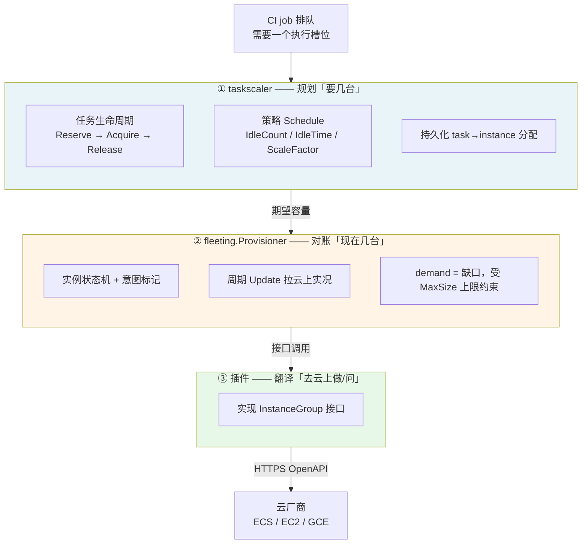
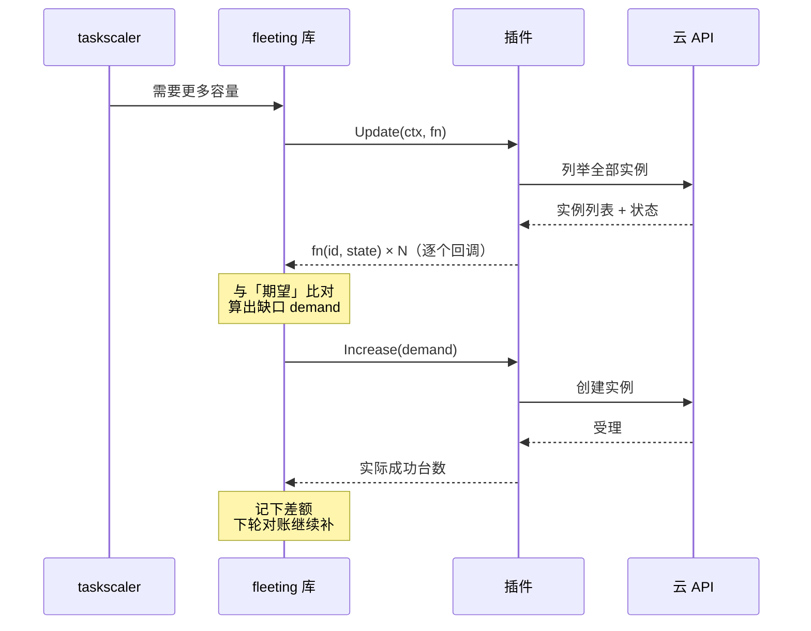
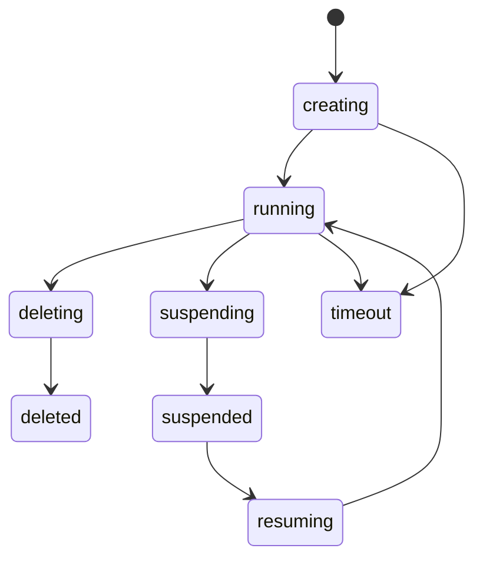
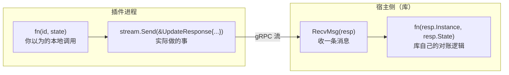
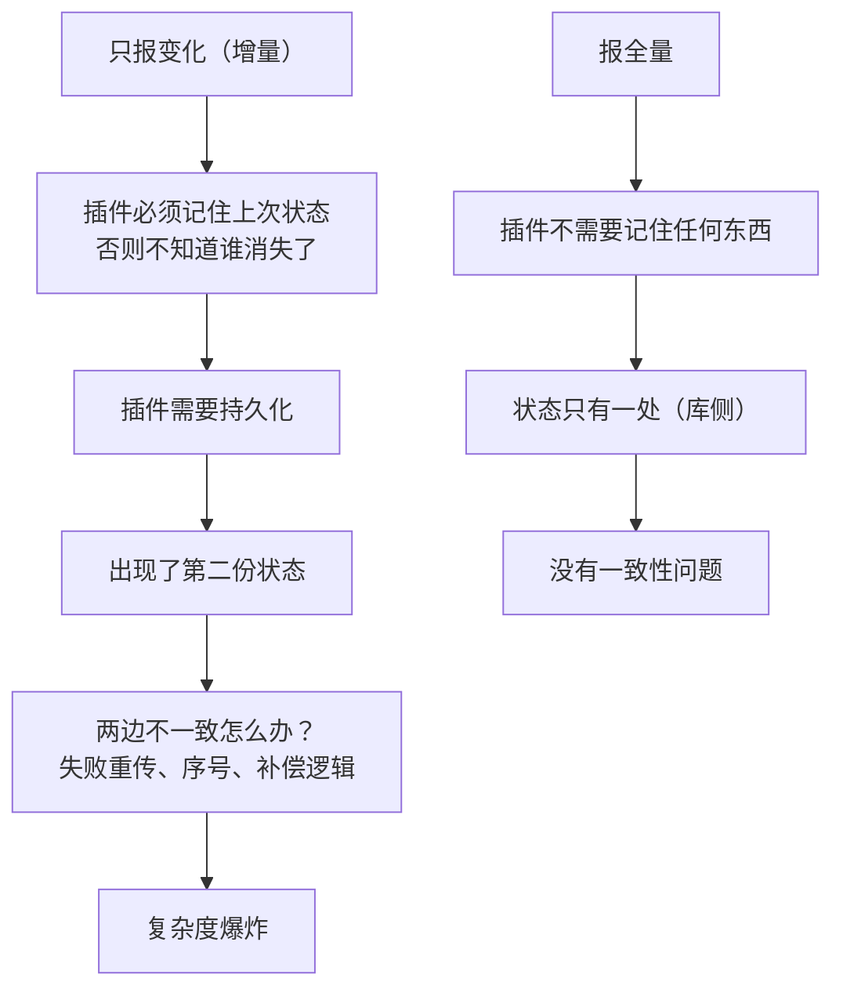

一个 CI job 排队了，需要一台新机器来跑。

几秒钟后，云上多了一台实例；job 跑完，实例被回收。整个过程没人干预。

这件事听起来平淡，但拆开看有**三个不同的问题**被三个不同的组件回答：

| 问题 | 谁回答 |
|---|---|
| 要几台？ | taskscaler（规划） |
| 现在几台？差多少？ | fleeting 库（对账） |
| 怎么让云上多一台？ | 插件（翻译） |

这篇文章按这三个问题往下拆，最后落在两个反直觉的设计取舍上：**插件的「回调」其实是 gRPC 流**，以及**为什么插件可以完全没有状态**。

---

## 一、全景：三层，各管一件事



**最关键的一句话**：插件是这套系统里**唯一不持状态**的一层。往下看你会知道这不是偷懒，是刻意设计。

---

## 二、规划层：抽象是「容量」，不是「机器数」

先破一个直觉：**不是「需要 3 台机器」，而是「需要 3 个槽位」**。

每台实例配一个 `capacity_per_instance`（默认 1），表示它能跑几个并发任务。官方文档的原话是：

> *each task is assumed to be the same size* —— 任务被假设为同尺寸，库只做簿记

所以扩缩容的判断对象是**容量**，机器数只是容量的换算结果：


**规划策略由 `Schedule` 决定**，一张表看全：

| 字段 | 作用 | 直觉 |
|---|---|---|
| `Periods` + `Timezone` | cron 表达式，分时段不同策略 | 白天多留、夜里少留 |
| `IdleCount` | 要维持的闲置容量 | 空转几台等任务上门 |
| `IdleTime` | 闲置容量保留多久再回收 | 别刚建好就删 |
| `ScaleFactor` | 按活跃任务数放大闲置容量 | 高峰期主动多备货 |
| `ScaleFactorLimit` | 放大上限 | 防止失控烧钱 |
| `PreemptiveMode` | 预约只能从已就绪容量分配 | 只排真正能立刻跑的 |

> 注意 `IdleCount` 和 `ScaleFactor` 的组合：**不是「有几台」，是「留多少余量」**——这是自动扩缩容里最容易被忽略的语义。

---

## 三、对账层：把「要几台」变成一次下发

到了这一层，问题变成：*现在云上有几台？离目标差多少？*

fleeting 库的做法是**周期性对账**（reconcile）——注意这套思路和 K8s controller 是同一套哲学：**声明期望状态，然后反复对比实际状态，差多少补多少**。

真正下发前，需求量要过两道闸（源码逻辑）：

```go
demand = len(request)                                     // 待满足的请求数
capacity = MaxSize - len(pending) - len(instances)        // 还剩多少可扩空间
if demand > capacity { demand = capacity }                // 上限约束
if demand <= 0 { return }
group.Increase(ctx, demand)                               // ← 下发到插件
```

两个上限来源：插件初始化时上报的 `MaxSize`，以及配置里的 `max_instances`——**取更严的那个**。



最后一行是重点：**`Increase` 返回的是「实际成功几台」，不是 error**。请求 3 台只成功 2 台是常态，库会记下差额，下一轮继续补。

---

## 四、接口层：一个动作，对应插件哪个方法

插件要实现的是 9 个方法。把「库想做什么」和「插件要做什么」对齐着看最清楚：

| 库要做什么 | 插件方法 | 插件对云做什么 |
|---|---|---|
| 启动 | `Init` | 解析配置、初始化客户端，上报 `MaxSize` 与能力 |
| 看现在有什么 | `Update` | 列举全部实例，逐个回调状态 |
| 要 N 台 | `Increase(n)` | 创建实例，返回成功台数 |
| 回收这几台 | `Decrease(ids)` | 删除实例，返回成功列表 |
| 要连上去跑 job | `ConnectInfo(id)` | 返回 IP / 用户 / 凭据 |
| 健康检查 | `Heartbeat(id)` | 查实例是否还健康 |
| 挂起 / 恢复（可选） | `Suspend` / `Resume` | 停机 / 开机 |
| 退出 | `Shutdown` | 清理 |

**实例状态是一个闭合的小状态机**：



从这个接口设计里能直接推出**两条硬约束**：

1. **操作必须幂等** —— `Increase`/`Decrease` 都是「部分成功」语义，没成功的下轮会被重试
2. **必须能「认领自己的实例」** —— `Update` 是全量列举，没有标记就会把同一个云账号下别人的机器当成自己的

---

## 五、反直觉之一：那个「回调」其实是 gRPC 流

`Update` 的签名长这样：

```go
Update(ctx context.Context, fn func(instance string, state State)) error
```

注意它**不返回数据，而是接收一个回调函数**。插件实现时看起来就是在调本地函数：

```go
func (g *MyGroup) Update(ctx context.Context, fn func(id string, state State)) error {
    for _, inst := range g.listInstances() {
        fn(inst.ID, translate(inst.Status))   // 看起来是本地调用
    }
    return nil
}
```

但插件是**独立进程**——这个 `fn` 怎么可能跨进程？

答案在协议定义里：

```proto
rpc Update(Empty) returns (stream UpdateResponse);
message UpdateResponse { string instance = 1; State state = 2; }
```

**`Update` 是一个 server-streaming RPC**：请求是空的，响应是一个流，流里每条消息就是一台实例的状态。

所以两侧看到的 `fn`，其实是两个不同的东西：



对照两边的桥接代码，一眼就清楚了：

*插件侧（框架生成的 wrapper）*

```go
func (s *server) Update(_ *proto.Empty, req proto.InstanceGroup_UpdateServer) error {
    return s.Impl.Update(req.Context(), func(instance string, state provider.State) {
        req.Send(&proto.UpdateResponse{Instance: instance, State: stateVal})  // ★ 发流消息
    })
}
```

*宿主侧（库的客户端）*

```go
func (c *client) Update(ctx context.Context, fn func(string, provider.State)) error {
    updater, _ := c.client.Update(ctx, empty)
    for {
        if err := updater.RecvMsg(resp); errors.Is(err, io.EOF) { return nil }
        fn(resp.Instance, provider.State(resp.State.String()))                // ★ 调本地逻辑
    }
}
```

> 一次 `Update` = 一次「云上实况」的**全量快照推流**。插件遍历完所有实例后返回，流就 EOF 结束。
>
> 这个设计的价值：**把「跨进程推数据」伪装成「函数调用」**——写插件的人完全不用懂 gRPC、不用管序列化。

---

## 六、反直觉之二：为什么要全量，而不是只报变化

既然每次 `Update` 都推全量，那能不能优化成「只汇报有变化的实例」？

第一反应是能。但往下推一步就会发现坑：



**关键前提**：宿主与插件**同机**。官方设计文档明确假设「本地可靠网络」——传输几乎免费，所以全量没有成本压力。

于是这条链就成立了：

> 同机传输免费 → 不需要增量优化 → 插件不必记状态 → **插件可以完全无状态** → 状态只有一处 → 没有一致性问题

全量快照还白送两个好处：

| 好处 | 说明 |
|---|---|
| 天然容错 | 某轮 `Update` 失败，下一轮自动纠正——不需要任何补偿逻辑 |
| 能发现「你不知道的存在」 | 有人手动在云控制台开了一台机器，全量下一轮就看见（会被标记为「计划外实例」）；增量方案永远发现不了 |

这里有个容易推过头的边界：**插件可以缓存「信号」，但不能持有「状态权威」**。

举例：抢占式实例被云回收时会发通知，插件可以把这个通知缓存下来，下次 `Heartbeat` 时返回「不健康」。这是**一次性信号**，不是生命周期状态的归属——状态机始终在库这边。

---

## 七、落地：把自家云接进来

上面讲的都是接口契约，实际接入时最容易踩的三个坑：

| 坑 | 原因 | 对策 |
|---|---|---|
| 认领了别人的机器 | `Update` 是全量列举 | 创建实例时打标签，列举时按标签过滤 |
| 重试导致重复操作 | 部分成功语义下库会重试 | 所有操作幂等：「已不存在」要当作成功返回 |
| Runner 连不上机器 | 把「创建中」提前报成了「运行中」 | 状态映射要诚实，中间态如实上报 |

**部署形态**也值得记一笔：插件是一个**独立进程**（不是库、不是 sidecar），通过 go-plugin 握手后走 gRPC 通信。用官方的安装命令可以把二进制放到约定目录，然后在 Runner 配置里按名字引用它 + 传一段插件自定义的 JSON 配置。

---

## 八、延伸：自动扩缩都看不懂「非默认调度语义」

这个问题在集群侧有一个**结构完全相同的版本**。

K8s 的 Cluster Autoscaler 判断「要不要扩容」的依据是：**有一个 Pod 因为资源不足调度不上去**。它按单个 Pod 的视角做模拟调度——这台 Pod 塞得进现有节点吗？塞不进就扩容。

但如果集群用的是 gang 调度（比如 batch 调度器），语义就变了：**整组 Pod 必须全部能运行才会被调度，否则整组等待**。于是出现经典的错配：

- CA 看到的：某个 Pod 塞得下 → 判定「不需要扩容」
- 调度器判断的：整组差一台机器才够 → 整组不调度

**两边对「能不能调度」的判断基准不同，联动就断了。**

有意思的是，这两个坑本质是同一个命题：

> **自动扩缩容机制默认按「默认调度语义」理解世界；一旦上层引入自定义语义（gang 调度、容量抽象），它就读不懂了。**

解法方向也一致：**把上层语义翻译成扩缩容器能听懂的语言**——集群侧是让 PodGroup 的状态能被 CA 识别，Runner 侧是让插件把云上的实况翻译成标准状态回传。

---

## 一句话总结

**taskscaler 决定「要几台」，fleeting 库管「状态机和对账」，插件只管「把指令翻译成云 API + 报实况」。**

插件无状态不是偷懒，是用「声明式全量快照」换掉了「增量上报 + 两份状态 + 一致性难题」——而这一切的前提，是宿主与插件同机这个看似不起眼的部署假设。
