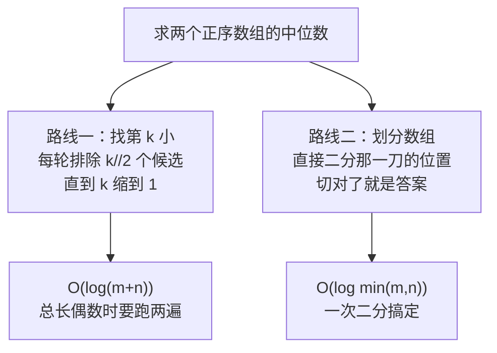
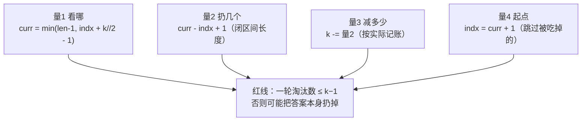

## 题目

给定两个大小分别为 `m` 和 `n` 的正序（从小到大）数组 `nums1` 和 `nums2`。请你找出并返回这两个正序数组的 **中位数**。

算法的时间复杂度应该为 `O(log (m+n))`。

**示例 1：**

```text
输入：nums1 = [1,3], nums2 = [2]
输出：2.00000
解释：合并数组 = [1,2,3] ，中位数 2
```

**示例 2：**

```text
输入：nums1 = [1,2], nums2 = [3,4]
输出：2.50000
解释：合并数组 = [1,2,3,4] ，中位数 (2 + 3) / 2 = 2.5
```

**提示：**

| 约束 | 值 |
|---|---|
| `nums1.length == m` | — |
| `nums2.length == n` | — |
| `0 <= m <= 1000` | — |
| `0 <= n <= 1000` | — |
| `1 <= m + n <= 2000` | 不会同时为空 |
| `-10⁶ <= nums1[i], nums2[i] <= 10⁶` | — |

> 原题链接：[4. 寻找两个正序数组的中位数](https://leetcode.cn/problems/median-of-two-sorted-arrays/)

---

这道题是 LeetCode 上少有的「题面一句话、动手就懵」的困难题。真正卡住人的从来不是中位数的定义——而是那个 `O(log(m+n))`：**一看到 log 就知道要二分；但两个数组长度不同、还没合并，到底该在什么上面二分？**

我前后写了五版代码才 AC。前三版分别死在下标与 k 的混淆、边界不收缩、索引抄错；第四版思路对了但把一个 `-1` 写丢，第五版才过。回头看，这五个坑其实是**同一类错误的五个变体**——off-by-one。

所以这篇分三块：先把两种正解讲透（找第 k 小、划分数组），附真实 benchmark 对比；最后把我那几版废代码逐个解剖——**它们比正确答案更值得看，因为每一个都对应一个你很可能也会踩的思维陷阱。**

---

## 一句话本质

> **中位数不是「排序后中间那个」，而是「能把两个数组切成等长两半的那一刀」。**
>
> 两种解法从两条路走到同一个地方：**数第 k 个**，和**找那一刀**。

两种解法的路线差异：



两条路都要求同一个前提：**数组有序**。但用它的方式完全不同——路线一用「有序」来**排除**，路线二用「有序」来**定位**。

---

## ① 常规解：找第 k 小

### 从「合并」到「不合并」

最直观的两条路都不满足要求：

| 思路 | 时间 | 空间 | 问题 |
|---|---|---|---|
| 合并两个数组再取中间 | O(m+n) | O(m+n) | 慢，还多开内存 |
| 双指针边走边数到中间 | O(m+n) | O(1) | 省了空间，时间还是线性 |

要压到 log，必须换思路。第一步转化是**把中位数问题变成第 k 小问题**：

```text
总长 m+n 为奇数 → 中位数 = 第 (m+n+1)/2 小的数
总长 m+n 为偶数 → 中位数 = 第 (m+n)/2 小 与 第 (m+n)/2+1 小 的平均
```

于是问题变成：**在两个有序数组里找第 k 小，且要 O(log)。**

### 核心：每轮扔掉一半

找第 k 小，最朴素的办法是每次从两个数组头部取走更小的那个，走 k 步——但那是 O(k)。

二分的做法是：**每轮一次性排除掉 k/2 个绝不可能是答案的候选。**

关键在于「看哪个元素」。取两个数组各自区间内的**第 k/2 个**元素作比较：

```text
nums1: [ i ................ ci ] | .........
              ↑ 区间内第 k//2 个
nums2: [ j ................ cj ] | .........
              ↑ 区间内第 k//2 个

比较 nums1[ci] 和 nums2[cj]
```

假设 `nums1[ci] <= nums2[cj]`，那么：

> 比 `nums1[ci]` 小的元素最多只有 `(k/2 - 1) + (k/2 - 1) <= k - 2` 个，
> 所以 `nums1[ci]` 最多排到第 `k-1` 位——**它不可能是第 k 小，它前面那半段更不可能。**

于是把 `nums1` 的 `[i .. ci]` 整段扔掉，k 相应减少，继续下一轮。

### 三件套：看哪 / 扔几个 / 减多少

整个算法的正确性，只依赖一句话：

> **每轮淘汰掉的那些元素，必须能被证明「不可能是第 k 小」；而且淘汰了几个，k 就必须正好减几个。**

这句话拆成四个量，每一个都是独立的：

| 量 | 表达式 | 含义 | 关键点 |
|---|---|---|---|
| 看哪 | `ci = min(i + k//2 - 1, m-1)` | 区间内第 k//2 个元素的下标 | 第 t 个元素的下标 = 起点 + t − 1 |
| 扔几个 | `ci - i + 1` | 左闭右闭区间的长度 | 两端都算，所以 +1 |
| 减多少 | `k -= 扔几个` | k 的记账 | 必须等于【实际】扔掉的数量，不是计划值 |
| 起点 | `i = ci + 1` | 下一轮的起点 | 跳过被扔掉的那一位 |

📌 **两个 `+1` 不是一回事**：`ci - i + 1` 的 `+1` 是「闭区间长度」，`ci + 1` 的 `+1` 是「跳到下一位」。它们只是恰好都涉及 1，绝不能理解成「前面减了 1 所以后面补 1」——那是凑数，换个写法就崩。

📌 **`min(..., m-1)` 也不能省**：如果 `i + k//2 - 1` 越过了数组末尾，说明这个数组剩下的元素还不够 k/2 个。此时只能取到末尾，**实际扔掉的数量小于 k/2**——这正是上面「减多少必须等于实际扔几个」的意义所在。

### 为什么被扔的可以扔：把证明补完

上面对 `nums1[ci]` 的排名估计还差一步。设：

- `a` = 本轮从 nums1 扔掉的个数（= `ci - i + 1`，未夹边界时就是 `k//2`）
- `b` = nums2 中位于 `cj` 及之前的个数（= `cj - j + 1`，未夹边界时也是 `k//2`）

比 `nums1[ci]` **小**的元素最多有：

```text
nums1 侧：a - 1 个        ← 靠「nums1 内部有序」：ci 是本段第 a 个
nums2 侧：b - 1 个        ← 靠「nums1[ci] <= nums2[cj]」：比它小的 nums2 元素
                             只能出现在 cj 之前
─────────────────────────
合计   ：a + b - 2 个
```

所以 `nums1[ci]` 的排名 ≤ `a + b - 1 = 2·(k//2) - 1 ≤ k - 1`。

**它排不进第 k 位，整段更不可能。**

| 前提 | 提供的东西 | 少了会怎样 |
|---|---|---|
| nums1 内部有序 | 段内 a−1 个元素 ≤ `nums1[ci]` | 段内没法整体打包扔掉 |
| 跨数组比较 `nums1[ci] <= nums2[cj]` | nums2 侧比它小的上界 b−1 | 上界算不出来，红线守不住 |

⚠️ **这两个前提缺一不可**——这也是后面「坑③」的根源：只看两个数组的**队首**谁小，推不出段内最大者也小。

### 完整代码

```python
from typing import List


class Solution:
    def findMedianSortedArrays(self, nums1: List[int], nums2: List[int]) -> float:
        m, n = len(nums1), len(nums2)

        def getKthElement(k: int) -> int:
            """返回两个正序数组中第 k 小的数（k 从 1 开始计数）"""
            i = j = 0                          # i / j：两个数组各自的起点
            while True:
                if i >= m:                     # nums1 已耗尽
                    return nums2[j + k - 1]
                if j >= n:                     # nums2 已耗尽
                    return nums1[i + k - 1]
                if k == 1:                     # 只剩找最小值
                    return min(nums1[i], nums2[j])

                # ① 看哪：各自区间内「第 k//2 个」元素的下标，并用数组末尾夹住
                ci = min(i + k // 2 - 1, m - 1)
                cj = min(j + k // 2 - 1, n - 1)

                # ② 扔谁 + ③ 记账
                if nums1[ci] <= nums2[cj]:
                    k -= ci - i + 1            # 扔掉几个就减几个（闭区间长度）
                    i = ci + 1                 # 起点跳到被扔掉那位的下一位
                else:
                    k -= cj - j + 1
                    j = cj + 1

        if (m + n) % 2:
            return float(getKthElement((m + n + 1) // 2))
        return (getKthElement((m + n) // 2) + getKthElement((m + n) // 2 + 1)) / 2.0
```

用官方那个例子走一遍（`A = [1,3,4,9]`，`B = [1..9]`，总长 13，找第 7 小）：

| 轮次 | k | 比较 | 结论 | k 变化 | 起点变化 |
|---|---|---|---|---|---|
| 1 | 7 | `A[2]=4` vs `B[2]=3` | A 大 | k = 7−3 = 4 | j: 0→3 |
| 2 | 4 | `A[1]=3` vs `B[4]=5` | A 小 | k = 4−2 = 2 | i: 0→2 |
| 3 | 2 | `A[2]=4` vs `B[3]=4` | 相等，扔 A | k = 2−1 = 1 | i: 2→3 |
| 4 | 1 | `A[3]=9` vs `B[3]=4` | 取 min | 返回 4 ✅ | — |

> **一句话总结**：把「求中位数」变成「找第 k 小」，再用「每轮砍掉 k/2 个候选」把线性搜索压成对数——而砍人的依据是**两个数组各自区间内的第 k/2 个元素**。

---

## ② 另一种解：划分数组

方法一的复杂度已经达标了，但还有一条更漂亮的路，能把 `O(log(m+n))` 压到 **`O(log min(m,n))`**。

### 视角反转：中位数是一刀

中位数在统计学里的作用，是**把一个集合切成两个长度相等的子集，且前一个子集里的元素总是不大于后一个子集**。

顺着这个定义，在任意位置切一刀：

```text
           前半 left_part                |            后半 right_part
  A[0], A[1], ..., A[i-1]                |   A[i], A[i+1], ..., A[m-1]
  B[0], B[1], ..., B[j-1]                |   B[j], B[j+1], ..., B[n-1]
                ↑ i 是 A 的切点                         ↑ j 是 B 的切点
```

只要同时满足两个条件，这一刀就是答案：

| 条件 | 内容 | 意义 |
|---|---|---|
| ① 长度 | `i + j = (m+n+1) / 2`（整除） | 前半比后半多 1 个（奇数）或一样多（偶数） |
| ② 有序 | `A[i-1] <= B[j]` 且 `B[j-1] <= A[i]` | 前半的最大值 ≤ 后半的最小值 |

满足后，答案直接读出来：

```text
总长奇数 → 中位数 = max(left_part)
总长偶数 → 中位数 = ( max(left_part) + min(right_part) ) / 2
```

### 两个条件 → 一个二分

条件 ① 有个关键作用：**i 和 j 是联动的**，定了 i 就定了 j：

```text
j = (m+n+1) / 2 - i
```

所以根本不用二维搜索，只要在 `i ∈ [0, m]` 上二分就行。

再规定 `m <= n`（不满足就交换两个数组），这样 `j` 永远落在 `[0, n]` 里——不需要额外检查 j 越界。

条件 ② 也可以简化。可以证明它等价于：

> 在 `[0, m]` 中找到**最大的** `i`，使得 `A[i-1] <= B[j]`。

理由：`i` 递增时 `A[i-1]` 递增、`B[j]` 递减（因为 j 随 i 反向变化），所以「满足 `A[i-1] <= B[j]` 的 i」必然是一段前缀——**单调性成立，可以二分。**

于是整个算法变成：二分 i，每次检查 `A[i-1] <= B[j]`，成立就记下当前答案并往右走，不成立就往左收。

### 二分过程走一遍

用官方例子 `nums1 = [1,3,4,9]`（m=4），`nums2 = [1,2,3,4,5,6,7,8,9]`（n=9），总长 13 是奇数，前半要放 `(13+1)/2 = 7` 个：

| 轮次 | 二分区间 | i | j | 前半 | 判据 `nums1[i-1] <= nums2[j]` | 动作 |
|---|---|---|---|---|---|---|
| 1 | [0, 4] | 2 | 5 | `[1,3] + [1,2,3,4,5]` | `3 <= 6` ✅ | 记下 `max=5, min=4`，往右 |
| 2 | [3, 4] | 3 | 4 | `[1,3,4] + [1,2,3,4]` | `4 <= 5` ✅ | 记下 `max=4, min=5`，往右 |
| 3 | [4, 4] | 4 | 3 | `[1,3,4,9] + [1,2,3]` | `9 <= 4` ❌ | i 太大，往左收 |
| — | 结束 | — | — | — | — | `left > right` |

最后一次成功记下的 `max(left_part) = 4`，就是答案 **4.0**。

（验证：合并后 `[1,1,2,3,3,4,4,5,6,7,8,9,9]`，第 7 个正好是 4。）

### 哨兵：让边界情况不用特判

切点落在端点时（`i = 0`、`i = m`、`j = 0`、`j = n`），`A[i-1]` 这类取值会越界。与其写一堆 `if`，不如规定：

```text
A[-1] = B[-1] = -∞        A[m] = B[n] = +∞
```

含义很直观：

| 哨兵 | 场景 | 效果 |
|---|---|---|
| `-∞` | 该数组不出现在前半 | 不会影响前半的 `max` |
| `+∞` | 该数组不出现在后半 | 不会影响后半的 `min` |

### 完整代码

```python
from typing import List


class Solution:
    def findMedianSortedArrays(self, nums1: List[int], nums2: List[int]) -> float:
        # 让 nums1 是较短的那个：二分区间的长度才是 min(m, n)
        if len(nums1) > len(nums2):
            nums1, nums2 = nums2, nums1
        m, n = len(nums1), len(nums2)

        left, right = 0, m                 # 在 [0, m] 上二分切点 i
        median1 = median2 = 0              # 前半最大值 / 后半最小值
        while left <= right:
            i = (left + right) // 2
            j = (m + n + 1) // 2 - i       # i 定了，j 就定了

            # ±∞ 哨兵：切点越界时不影响 max / min
            nums_im1 = float("-inf") if i == 0 else nums1[i - 1]   # 前半 nums1 的最后一个
            nums_i = float("inf") if i == m else nums1[i]          # 后半 nums1 的第一个
            nums_jm1 = float("-inf") if j == 0 else nums2[j - 1]
            nums_j = float("inf") if j == n else nums2[j]

            if nums_im1 <= nums_j:         # 切对了
                median1 = max(nums_im1, nums_jm1)
                median2 = min(nums_i, nums_j)
                left = i + 1               # 记下当前答案，继续找更大的 i
            else:                          # i 太大，往左收
                right = i - 1

        return (median1 + median2) / 2.0 if (m + n) % 2 == 0 else float(median1)
```

> **一句话总结**：把「找中位数」换成「找那一刀」，用长度约束把二维搜索降成一维，用单调性把一维搜索变成二分——`O(log min(m,n))`。

---

## ③ 两种解法的实测对比

环境：Python 3.11，本机实测。两解法各跑 19870 组随机 + 边界用例对拍，**均为 0 失败**。

### 循环轮数（确定性指标，比挂钟时间更本质）

| m | n | 方法一 轮数 | 方法二 轮数 |
|---|---|---|---|
| 100 万 | 100 万 | 42 | 19 |
| 10 万 | 10 万 | 36 | 16 |
| 1000 | 1000 | 22 | 9 |
| 1000 | 100 万 | 4 | 10 |
| 1 | 100 万 | 2 | 2 |

**为什么方法一是 42 而不是 21？** 因为 `m+n` 是偶数时，它要**调用两次** `getKthElement`（找第 k 小和第 k+1 小各一次），两次都从头开始、无法复用——所以实际开销是 `2 × log(m+n)`。

方法二无论奇偶都是一次二分，`log(min(m,n)+1)` 直接封顶。

### 挂钟耗时（单次调用）

| 规模 | 方法一 | 方法二 | 倍数 |
|---|---|---|---|
| 各 10 万元素 | 22.63 μs | 14.66 μs | 1.54× |
| 各 100 万元素 | 31.20 μs | 6.19 μs | 5.04× |
| 1 vs 100 万 | 2.26 μs | 2.74 μs | 0.82× |
| 1 vs 2000 万 | 3.09 μs | 2.27 μs | 1.36× |

### ⚠️ 一个反直觉的点

**数组长度悬殊时，方法一的轮数反而极少。**

`m = 1000, n = 100 万` 时方法一只要 **4 轮**：短数组在第一轮就被整段清空，之后直接命中 `i >= m` 的提前返回分支。此时方法二的 `log min(m,n)` 优势根本体现不出来——第 3 行「1 vs 100 万」的耗时甚至**反超**方法二。

所以「`O(log min(m,n))` 一定优于 `O(log(m+n))`」是个过于粗糙的结论：**理论复杂度管的是最坏情况，实际表现要看两个数组的长度比例。**

### 怎么选

| 场景 | 推荐 | 理由 |
|---|---|---|
| 面试手写 | 方法一 | 思路直观，三件套边界清楚，好讲 |
| 追求复杂度最优 | 方法二 | 一次二分，偶数不双跑 |
| 数组长度悬殊 | 方法一 | 短数组迅速耗尽，提前返回 |
| 写进生产代码 | 方法二 | 常数小，且没有「k 变成 0」这类隐患 |

> **一句话总结**：两者都是对数级，方法二在最坏情况（两个数组都很大且接近）胜出 2 倍以上轮数；但长度悬殊时方法一反而更快——**别背复杂度，要看输入形状。**

---

## ④ 我摔过的坑（精选三个）

下面是我真实写挂的几版代码。统一用同一批 **4967 组**用例对拍（随机 + 手工边界），失败率可比：

| 版本 | 失败数 | 失败率 | 首个最小反例 |
|---|---|---|---|
| 坑① 拿下标当 k 减 | 3921 | 78.9% | `[1,3] + [2]` 期望 2.0，实得崩溃 |
| 坑② 边界不收缩 | 996 | 20.1% | `[1] + [2,3,4,5,6,7]` 期望 4.0，实得 3.0 |
| 坑③ 比队首而非 pivot | 913 | 18.4% | `[1,100,101] + [2,3,4]` 期望 3.5，实得 3.0 |
| 坑④ `curr` 不减一 | 2830 | 57.0% | `[1,3] + [2]` 期望 2.0，实得 1.0 |
| ✅ 最终正确版 | 0 | 0% | — |

这三个坑恰好对应「三件套」里的三个量，一个不落。

### 坑① 拿下标当 k 减（失败率 78.9%）

```python
if nums1[indx1] < nums2[indx2]:
    k -= indx1          # ❌ 拿本数组下标去减全局的 k
    indx1 += k // 2     # ❌ 又用已被改小的 k 去算步长
```

这里混淆了两个**量纲完全不同**的东西：`indx1` 是「本数组内已排除的个数」，`k` 是「全局剩余要找第几小」。

执行起来是这样的（`nums1=[1,2,3] nums2=[4,5,6]` 求第 3 小）：

```text
step1: k=3 indx1=0 → k-=0 → k=3      indx1 += 3//2 → 1
step2: k=3 indx1=1 → k-=1 → k=2      indx1 += 2//2 → 2
step3: k=2 indx1=2 → k-=2 → k=0      indx1 += 0//2 → 2   ← 原地踏步
step4: k=0 indx1=2 → k-=2 → k=-2     indx1 += (-2)//2 → 1 ← 指针倒退
step5: ... 在负数区间来回震荡，永远到不了 k == 1 → 死循环
```

⚠️ 注意 step1：`indx1 = 0` 时 `k -= 0` 什么都没发生。**这就是这个 bug 最阴的地方——指针只要还停在 0 号位，一切正常；一旦离开 0，k 立刻被污染。**

### 坑② 边界不收缩（失败率 20.1%）

```python
if nums1[indx1] < nums2[indx2]:
    indx1 += k // 2      # ❌ 没检查会不会越过数组末尾
k -= k // 2              # ❌ 减的是「计划扔多少」而不是「实际扔了多少」
```

最小反例：`nums1=[1] nums2=[2,3,4,5,6,7]` 求第 4 小（答案 4）：

```text
第1轮: k=4, k//2=2
       indx1 += 2 → indx1 = 2   （但 m=1，已经越界！实际只扔掉了 1 个元素）
       k -= 2 → k = 2           （k 却减了 2）
第2轮: indx1 >= m → 取 nums2[0 + 2 - 1] = nums2[1] = 3   ❌ 期望 4
```

**nums1 物理上只剩 1 个元素可扔，k 却减了 2**——等于谎报战果：声称扔了 2 个，实际只扔了 1 个，后面的定位就整体漂移了一位。

正确写法是把「步长」和「k 减量」解耦：

```python
ci = min(indx1 + k // 2 - 1, m - 1)   # 先夹住边界
k -= ci - indx1 + 1                    # 按【实际】扔掉的个数记账
indx1 = ci + 1
```

> **一句话总结**：`k` 的减量要跟**物理事实**对账，不能跟**计划**对账。

### 坑③ 比队首而非 pivot（失败率 18.4%）

这一版**边界对了、k 的记账也对了**，唯一区别是判定依据改成了「谁的两个队首更小」：

```python
if nums1[indx1] < nums2[indx2]:    # ❌ 看的是第 1 个，不是第 k//2 个
```

反例 `nums1=[1,100,101] nums2=[2,3,4]`（答案 3.5）：

```text
队首 1 < 2 → 判定 nums1 小 → 扔掉 nums1 的前 2 个 [1, 100] 😱
```

**`100` 被误杀了。** 队首小 ≠ 段内最大者小——`nums1` 内部有序，但 `100` 在全局里一点都不小。

回到前面的正确性证明：结论是「`nums1[ci]` 的排名 ≤ `a + b - 1`」，其中 `b - 1` 那一项**必须**来自 `nums1[ci] <= nums2[cj]` 这个跨数组比较。只看队首，`b` 就无从算起，红线自然守不住。

📌 顺带一提：我有一版还把 `nums1[indx1 + k - 1]` 抄成了 `nums1[indx2 + k - 1]`（用另一个数组的游标去索引）。这种纯手误反而「失败率最低」（5.4%）——因为触发条件苛刻，很多用例碰巧躲过去了。**失败率低不等于错得轻，只是错得隐蔽。**

### 归纳：三个量 + 一条红线



| 坑 | 错在哪个量 | 本质 |
|---|---|---|
| 坑① 拿下标当 k 减 | 量3 | 量纲混淆：数组下标 ≠ 全局排名 |
| 坑② 边界不收缩 | 量2 + 量3 | 用「计划值」而非「实际值」记账 |
| 坑③ 比队首 | 量1 | 看错位置，判据失去证明力 |

**「减一」不是为了让括号配平，而是为了让每轮淘汰量 ≤ k−1。** 这是整道题唯一真正需要背下来的约束。

---

## 一句话记住

> **求中位数 = 求第 k 小，或者 = 找那一刀。**
>
> 找第 k 小：看各自区间第 k/2 个，小的那侧整段扔掉，扔几个就减几个。
> 划分数组：用长度约束把 i 和 j 绑死，二分那一刀。
>
> 而所有的 bug，都出在「看哪 / 扔几个 / 减多少」这三个量没有严格自洽。
