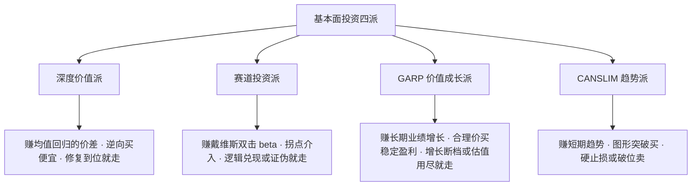
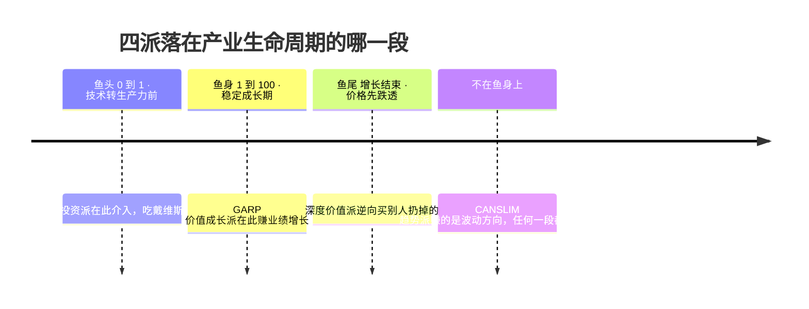
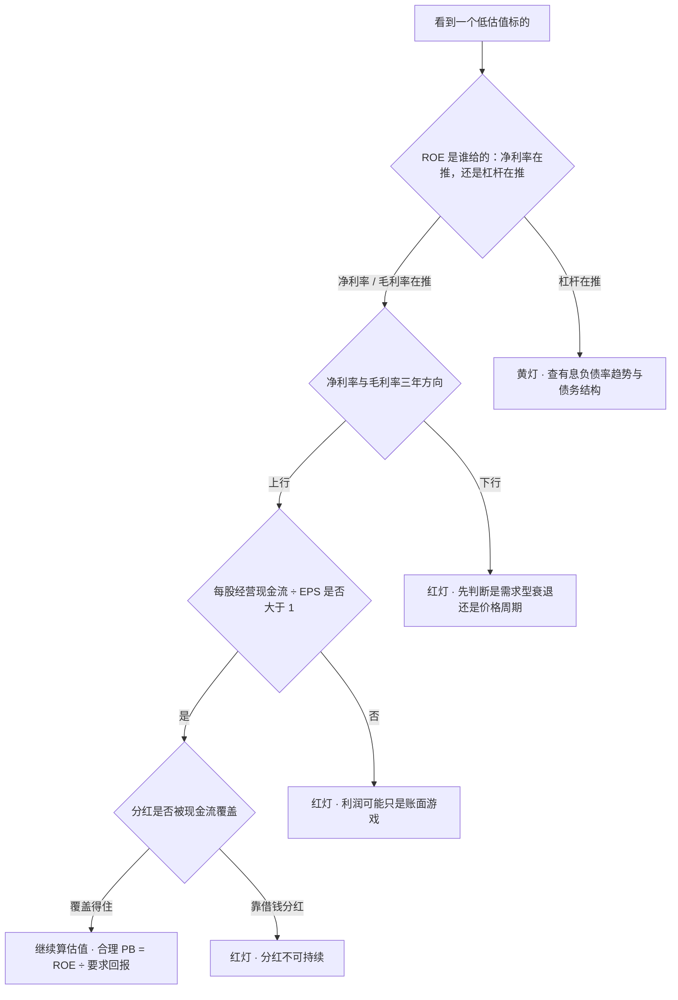

> **主引用**：《基本面投资四大门派的道与术》—— 国金证券研究所 · 艾熊峰（SAC S1130519090001），2022-02-14 ｜ [原文 PDF](https://pdf.dfcfw.com/pdf/H3_AP202202151547130006_1.pdf)
> **跨厂佐证**：[华尔街见闻转载（2022-02-15）](https://wallstreetcn.com/articles/3652054)
> **我的阅读数据**：微信读书 PDF 导入版，全书 1 章 12,577 字；划线 14 条、想法 4 条，读完于 2026-10-18
> **标注规则**：`[原文]` = 研报原话 ｜ `[实测]` = 本文用真实财报/行情数据算出的数 ｜ `[延伸]` = 本文的推理补充（原文没有这个说法）

这份研报我在微信读书里以 PDF 形式读完，全书只有一章。

它的价值不在结论，而在于把"基本面投资"拆成四个可以互相对照的派别。照完之后我第一次能说清：我站在哪儿，以及我缺的是哪一块。

读的过程中我划了 14 条线、写了 4 条批注。三条留到现在：

> 💭 在 CANSLIM 趋势投资派那一段旁：**"这个其实最务实，也是我最大的短板"**
> 💭 在赛道投资派那一段旁：**"在技术转换为生产力前介入，享受成长的收益。风险就是如何判断技术的价值。"**
> 💭 在深度价值派那一段旁：**"散户最容易的还是宏观流动性危机下找质地好的低估值优质股"**

下面是读完之后的整理：四派一览（补上它们没写的卖点）、我自己的定位，以及一张从原文那句话推出来、原文并没有给的表。

## 一、四派一览：各赚哪种钱、什么时候必须卖

| 派 | 收益来源 | 买点 | 卖点 |
|---|---|---|---|
| 深度价值 | 错误定价 → 均值回归的价差 | 便宜到有安全边际，逆向买 | 估值修复到位；或落进价值陷阱 |
| 赛道投资 | 行业拐点 × 戴维斯双击（beta） | 渗透率起步、技术转生产力前 | 逻辑兑现或证伪（渗透率饱和 → 鱼尾） |
| GARP 价值成长 | 长期业绩增长推着市值走 | 合理价买持续稳定的盈利能力 | 增长断档；估值容忍度用尽 |
| CANSLIM 趋势 | 短期趋势的价差 | 基本面入选 + 图形突破 | 硬止损 / 跌破平台 / 破均线 |

> 收益来源与买点出自原文导言 [原文]；**卖点里只有趋势派是原文给的**，其余三派的卖点是我自己推的 [延伸]。

三个容易漏掉的细节 [延伸]：

- **GARP 的门槛是"持续稳定"，不是"能成长"。** 任何赛道股都能成长，但能把盈利稳定续上十年二十年的很少——这条门槛决定了它只能选白马，不能选故事。
- **趋势派的卖点必须化成可观察量。**「趋势反转」是结论不是信号。能写进交易系统的版本只有这几条：跌破买入平台、-7%~-8% 硬止损、跌破 20/50 日线、大盘（CANSLIM 的 M）转弱。
- **"对估值有一定容忍度"是有上限的。** 上限就是成长率能解释的那部分（PEG 的思路）：PE 30 配 30% 增长站得住，配 10% 增长就站不住。容忍度一旦被当成"好公司可以随便贵"，它就从纪律变成了借口。

## 二、我站在哪一派：组合式

我给自己选的不是单一门派，而是组合式：**深度价值做仓位主力，GARP 只用来做"允许好公司贵一点"的例外**。

关于赛道派的取舍，我写下的理由是：**"赛道这个比较难把握"**——行业拐点这件事，我没有判断力上的优势。

**四派落在产业生命周期的哪一段**，这是原文没画、但我觉得最有用的一张图：

**我的估值锚是怎么算出来的** [延伸]

我平时用的锚是"股息率到 6% 才买"。把两个公式接起来看，会发现它等价于同一个参数：

| 要求回报 | 合理 PB（= ROE ÷ 要求回报） | 对应价（BPS 8.64 元） | 另一条路：6% 股息率锚 |
|---|---|---|---|
| 10% | 2.09 | 18.03 元 | — |
| 8% | 2.61 | 22.54 元 | 23.00 元（差 2%） |
| 6% | 3.48 | 30.05 元 | — |

[实测] 伊利 2025 年报 EPS 1.83 元、全年每股分红 1.38 元 → payout 75.4%；6% 股息率锚 ÷ 75.4% = 要求回报 7.96% ≈ 8%。

也就是说：**我的要求回报早就填成了 8%，只是没写下来。** 两条路（股息率锚、合理 PB）算出的买点几乎重合。

## 三、价值陷阱体检表：原文那句话的可操作版本

原文里对我最有用的是一句判断，而它没有给标准：

> "深度价值投资最重要的是要避开价值陷阱，这需要回到基本面研究，最重要的是对公司盈利能力进行深度挖掘。" [原文]

把"深入挖掘"拆成六个能直接查的问题：

拿两个真实标的走一遍（数据为 2026-10-16 收盘口径 [实测]）：

| 问 | 可观察量 | 伊利 600887 | 神火 000933 |
|---|---|---|---|
| 1 ROE 是谁推的 | 有息负债率趋势 | 11.4%(2019) → 33.4%(2025) 🟡 | 48.9%(2022) → 18.3%(2025) 🟢 |
| 2 盈利能力趋势 | 净利率 / 毛利率 近 3 年方向 | 8.18 → 9.96；32.58 → 34.58 🟢 | 17.88 → 11.07；26.36 → 23.36 🔴 |
| 3 现金流质量 | 每股经营现金流 ÷ EPS | 2.27 / 1.83 = 1.24 🟢 | 3.89 / 1.81 = 2.15 🟢 |
| 4 分红可持续性 | payout + 现金流覆盖 | 75.4% 🟢 | 44.2% 🟢 |
| 5 低 PE 是"E 在动"吗 | ROE 波动幅度（近 7 年） | 15.8%–26.4% 🟢 | 7.7%–57.4% 🔴 |
| 6 净资产质量 | 商誉 ÷ 归母净资产 | 1.2% 🟢 | 0.0% 🟢 |

再用我的锚验一次价（合理 PB = ROE ÷ 8%）：

| | ROE(2025) | 合理 PB | 现 PB | 判定 |
|---|---|---|---|---|
| 伊利 | 20.87% | 2.61 | 3.32 | 贵 27% |
| 神火 | 17.49% | 2.19 | 2.08 | 便宜 5%，但 ROE 是价格给的 |

结论只有一句：**价值陷阱的判定不在"估值低不低"，而在"这个 ROE 是谁给的"。**

- 伊利是"生意给的、但价格贵"：现金流、分红、盈利趋势都健康，唯一的黄灯是有息负债率六年翻了近三倍；按 8% 要求回报，现价贵 27%。
- 神火是"价格给的，所以便宜 5% 不算便宜"：ROE 从 57.4%（2022）掉到 17.49%（2025），PE 8.37 低是因为分子用了景气顶部的 E。它的正确买点不在利润暴涨之后，而在行业亏损、高成本产能出清、价格贴着成本线横盘的时候。

## 四、纪律那一课：止损为什么是数学必需

原文说趋势派"卖出时点上有严格谨慎的止盈止损原则，具有较强的交易纪律" [原文]。这句话看着平淡，但把它摊成数字就很刺眼——假设 10 笔交易里 6 笔小亏、3 笔小赚、1 笔大赚：

| 情景 | 6 笔小亏 | 3 笔小赚 | 1 笔大赚 | 合计 |
|---|---|---|---|---|
| 有硬止损（每笔 -1 出局） | -6 | +4.5 | +10 | 🟢 +8.5 |
| 不止损（亏损无上界，平均滑到 -4） | -24 | +4.5 | +10 | 🔴 -9.5 |

同一套选股能力，只差一条止损规则，期望从 +8.5 变成 -9.5。

所以止损的作用不是"少亏钱"，而是**把左尾截断**：让单笔亏损有上界，期望值才能由那一笔大赚决定。由此推出唯一真正重要的门槛——**大赚的幅度要 ≥ 6~9 倍单笔风险**，这生意才成立。至于 -7% 还是 -8%，一点都不重要，重要的是无例外。

对我这种持有型体系，这条纪律的边界是：**技术只管执行，不管"卖不卖一家好公司"**。不在超买时追高、分批建仓、单笔 -8% 无条件出局——这些归技术；要不要卖出一家基本面没坏的公司，归估值。

## 收尾：我留下的三句话

1. **"趋势做的就是小亏大赚的思路，让利润奔跑，控制亏损，做概率的生意。"**
2. **"散户最容易的还是宏观流动性危机下找质地好的低估值优质股。"**
3. **"这个（CANSLIM）其实最务实，也是我最大的短板。"**

---

## 附录 A：本文的原创边界

- **直接来自原文的内容**：四派的收益来源与买点（导言）、趋势派的止盈止损原则、"避开价值陷阱要回到基本面研究"这句判断、CANSLIM 七个特征的表述。
- **本文的延伸抽象（原文没有这些说法）**：第 1 节"四派没写的卖点"推演、鱼头／鱼身／鱼尾的座次、第 2 节要求回报与股息率锚的换算、第 3 节六问体检表与决策树、第 4 节止损的分布算术。
- 全文对原文的理解如有偏差，以 [原文](https://pdf.dfcfw.com/pdf/H3_AP202202151547130006_1.pdf) 为准。

## 附录 B：数据口径

- 行情与估值：腾讯行情接口，2026-10-16 收盘（2026-10-18 复核）；K 线为前复权。
- 财务数据：东方财富 F10 主要财务指标序列，年报口径（2019–2025）；`ROEJQ` 为加权 ROE、`INTEREST_DEBT_RATIO` 为有息负债率、`ZCFZL` 为资产负债率。
- 分红：东方财富分红明细按年度聚合的全年口径（中期 + 末期），伊利 2025 年度 1.38 元/股 = 中期 0.90 + 末期 0.48；神火 2025 年度 0.80 元/股。
- 股息率 = 最近一个完整年度每股派息 ÷ 现价，不是 TTM 口径。

## 参考来源

- 国金证券研究所 · 艾熊峰《基本面投资四大门派的道与术》（2022-02-14）：[PDF 原文](https://pdf.dfcfw.com/pdf/H3_AP202202151547130006_1.pdf)
- 华尔街见闻转载：[基本面投资四大门派的道与术](https://wallstreetcn.com/articles/3652054)（2022-02-15）
- 本人微信读书划线（14 条）与批注（4 条），导出的原文逐字笔记（2026-10-18）
