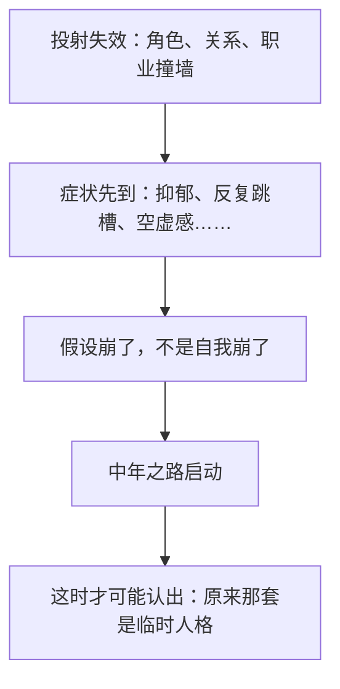
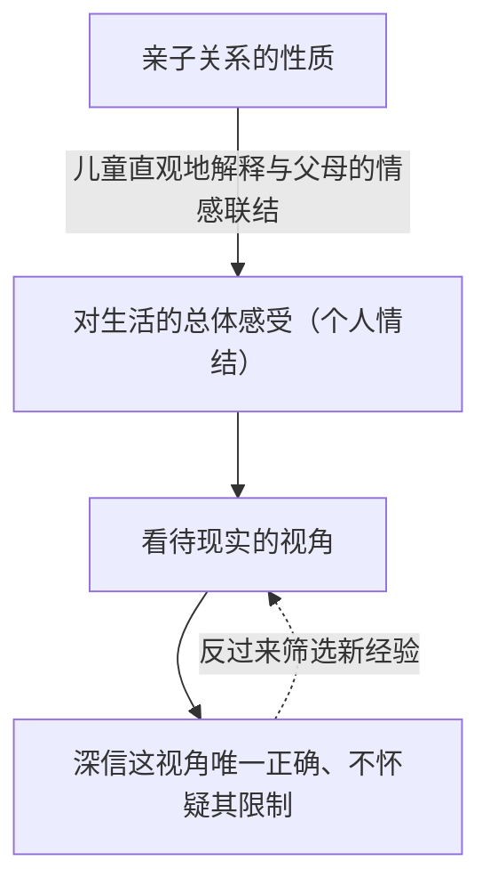

> **作者**：詹姆斯·霍利斯（James Hollis）
> **译者**：郑世彦
> **出版社**：浙江大学出版社（2022-12）
> **读完时间**：2026-10-02　|　**笔记整理**：2026-10-18
> **微信读书**：813 分 / 3288 人评价（"脍炙人口"）
> **我的阅读数据**：划线 117 条、想法 19 条，覆盖 29/44 章

我在读完时写下：

> 💭 "看了两遍，也快三十了，经历一些毒打也有一些体会，这本书真的蛮适合这个时间点看的。"

这句话是这本书的全部理由。它没有答案，但它把"我怎么了"从一种羞于启齿的疲惫，变成了一件**有结构、可解释、能动手**的事。

下面是我重读后留下的笔记——不是书摘汇编，是我把自己原来的理解逐条订正过一遍之后的版本。**加粗的部分，都是我曾经想反了、后来改过来的。**

---

## 一、不是"年纪到了"，是"假设崩了"

书里最有用的一句话是这句：

> "中年危机的体验不是**核心自我**的崩溃，而是一系列**假设**的崩溃。"

先说清三个概念，后面所有内容都挂在这三根钉子上：

| 概念 | 一句话 | 关键点 |
|---|---|---|
| 临时人格 | 为了被爱、被认可而长出来的适应性人格 | 真实存在、曾经有效，但不是"我的" |
| 投射 | 把自己身上未意识到的部分放到别人身上 | 撤回它 = 认领回来，不是删掉 |
| 个体化 | 从"扮演角色"走向"成为自己" | 既不压抑，也不无节制地行动 |

**我原来理解的顺序是反的。**我以为：先意识到自己的人格是临时的 → 于是开始探索 → 迎来中年之路。

书里的顺序是：



有两条划线把这个次序钉死了：

> "通常，在人们**意识到**危机之前，各种迹象和症状就已经出现了——抑郁、酗酒、吸食大麻、以促进性爱、出轨、反复跳槽，所有这些都是为了否认、忽视或摆脱内在的压力。"

> "背叛感、期望落空、空虚感和丧失意义，伴随着**投射的消解**而出现，形成了中年危机。"

⇒ 投射消解在前，"意识到危机"在后。

**这条订正对我最要紧**：我一直在等一个前提——"等我先想清楚我是谁、想要什么，再动"。而书里的答案是：**那个前提不会先来**，它是撞墙之后的产物，不是撞墙的门票。

---

## 二、临时人格：不是虚假，是"租来的"

既然叫"临时"，很容易理解成"假的、面具、要拆掉的东西"。这是我在第一轮就读错的地方。

它不是谎言。它是一个小孩为了在家庭里活下去，而**真实长出来的**一套应对方式——**它在当年是有效的，很多人靠它成功了很多年**。问题不在真假，在于它**不是自性的**：

> "自我从来就不在控制之中，而是被**父母和集体情结的能量**所驱动，被投射的力量所支撑——这些投射指向文化为即将成年的人提供的角色。"

> "我们已经习惯于**制度化**的角色，例如配偶、父母、工薪阶层，所以我们将自己的身份投射到这些角色上。"

所以判据不是"我有没有戴面具"，而是：

**这些角色在扮演我，还是我在扮演这些角色？**

一个更实用的观察角度：当一个角色（某份工作、某个身份、某种"我一直是这样的人"）被撤掉时，我剩下的那个人是谁？如果答案是"不知道"，那说明临时人格承担了太多——**它不是用来用的，它被当成了我本人**。

---

## 三、视角：一条单向的因果链，不是循环

我一度以为"童年经历"和"我看世界的视角"是互相塑造的循环。它有循环的那一半，但**起点是单向的**：



中间那一环是我原来漏掉的：

> "在儿童对自我和世界的认知过程中，虽然一些外部因素如战争、贫困或残疾起着重要作用，但对我们生活的**主要影响**来自亲子关系的性质。"

> "儿童会直观地解释他们与父母之间感觉和情感的联结，**以此作为对生活的总体感受**。"

如果只有循环，就变成宿命论了——反正互相塑造，动不了。但起点是清楚的：**先有"对生活的总体感受"，再有视角，再有"我永远是对的"这种感觉。**而"感觉"那一步是可以被看见、被说出来的，这就是可以动手的地方。

---

## 四、投射：情绪是入口，但方向不是"填补"

这一节是我订正幅度最大的一节。

我原来的理解是：情绪波动时检视"我缺什么"，然后把它补上。
书里的方向是：**情绪波动时检视"我把自己的哪一部分放到了别人身上"，然后认领回来。**

"缺"和"投射"是两回事：

| | 童年的空洞 | 未实现的自己（the unlived life） |
|---|---|---|
| 内容 | 缺爱、缺认可、缺安全感 | 被压住的天赋、欲望、童年的愿望 |
| 做法 | 向外抓：别人的爱、头衔、钱 | 向内认领：从别人身上收回来，自己练 |
| 结果 | 抓到了还是空 | 痛，但"适宜" |

书里把"向外抓"的结局写得很直白：

> "认识到童年不能重来，历史不能逆转，**没有人能神奇地填补内心的空洞**……人们迟早必须信任自己内在的资源，否则就会继续**徒劳地追求童年的幻想**。"

而正确动作的配方，是这句我自己划下来的话：

> "整合阴影，活出未实现的人生，关键是明白这一需求源于**自性**，它**既不希望进一步地压抑，也不希望无节制地行动**。"

### 嫉妒是最容易被眼睛看到的信号

> "我们必须审视自己**嫉妒和讨厌别人什么**，并承认那些只是自己的投射而已。这有助于防止我们因自己**未做之事**而责备或嫉妒他人。"

关键词是**"未做之事"**。我拿自己试过一次：当我看某类同行不顺眼时，剥掉"他用的方式不诚实"那层之后，底下是一句我不敢承认的话——**"他把价值讲了出来，而我没有。"**厌恶里藏着我未做的事，这句话是准的。

### 更坏的消息：一个投射可能只是被另一个投射所代替

这条我第一遍读的时候完全读反了。我以为"新投射会比旧的更符合现实，是阶段性成果"。书里说这是**更坏的消息**：

> "坏消息是，每个人都耗尽了投射身份的主要领域……好消息是，这种不满可以带来真正的更新……**更坏的消息是，一个投射可能只是被另一个投射所代替**；但即便如此，人们也会越来越接近与自性的约定。"

**为什么更坏？因为新投射通常只是更好看**：它更贴合自我形象，代价更隐蔽，所以更难被认出。

我自己在投资上有一个完整的小样本：

| 阶段 | 我当时相信的 | 结果 |
|---|---|---|
| 一 | "我比别人强，想到的都是对的" | 亏钱 |
| 二 | "这次不一样，我是价值投资者" | 顺风后全仓，又亏很多 |
| 三 | 不再判断自己比市场强：顺势、认错、买 ETF | 有了能活下来的规则 |

前两个阶段我都**以为自己这次更贴近现实**。真正变的不是投射对象变好了，而是第三阶段我开始看"**投射这个动作本身**"。

书里对这件事的态度很宽容：不是因为新投射更真，而是因为**每认出一次"这是我放出去的"，那个"我"就多一次被看见的机会**。这就是"越来越接近与自性的约定"。

### 三步操作

| 步 | 做法 | 反例 |
|---|---|---|
| ① 触发点 | 具体到场景、人、那一句话 | "最近情绪不稳" |
| ② 投射内容 | 我嫉妒/愤怒的哪个具体动作 | "他有钱" |
| ③ 认领动作 | 小到不会失败的动作为准，本周就做一次 | "我要变得外向" |

第③步的"小到不会失败"是有讲究的：如果给自己定大动作，很可能被自己那套"必须成功"的机制当场枪毙，然后得出"果然我不行"的结论——那正好是临时人格想要的结果。

---

## 五、劣势功能：专业化砍掉了什么

这一章我划了 8 条，是全书最密的地方之一。

> "我们在专业化上走得越远，人格受到的损害就越大，灵魂也就越迟钝。"

> "我们接受的训练越多且越成功，视野和人格也就越**狭隘**。"

> "荣格对神经症最简单的定义是'**自我分裂**'，即人格的**片面性**。"

荣格把心理功能分成四种，两两配对：

| 功能 | 管什么 | 我的状况 |
|---|---|---|
| 思维 T | 逻辑、因果、推演 | 主功能 |
| 感觉 S | 身体、当下、具体细节（累、饿、味道） | 强，但只用于"解题" |
| 情感 F | 值不值得、我愿不愿意、谁被冒犯了 | 弱：不太表达，堆积后爆发 |
| 直觉 N | 可能性、模式、愿景、联想 | 弱：对"画饼"有生理性反感 |

书里说，找回被专业化和禁止遗弃的自我，"**远不止告诫我们要培养一项爱好**"。

这句话我原来不懂，现在懂了一半：**爱好会被主功能接管**。如果我去培养一个爱好，它长出来大概是这样——健身记录 PR、跑步看配速、读书要"收获满满"。那不是劣势功能在动，那是**思维功能穿了爱好的衣服**。

真正的劣势功能练习有一个硬判据：**不问"这有什么用"，不记录，不比较，不精进。**

我个人最能说明这件事的例子：我说想找回"非功利的快乐"，结果我从书架上挑出来的，是最接近理性的那一类书。连非功利，我都会挑一个能被系统分析的。

---

## 六、职业与使命：我的唯一货币，和它的代价

> "**工作**是我们为了养活自己而不得不做的事情。**使命（vocatus）**则是我们被召唤用**生命能量**去做的事情。"

> "灵魂有它自己的需要，**工资和福利并不能满足它**。"

我在这两句话下面找到了自己的证据。有一类事我做了很多：改动没什么绩效收益，别人也不一定理解它为什么值得做——**而我还是做了，因为"能磨练"**。

"能磨练"是我的唯一货币：**凡是不能兑换成能力增长的（位置、被看见、关系、休息），在这台机器里一律不算数。**

它带来的好处很实在——我的内在标准不依赖外部发许可。它的代价同样实在：**我做的东西没有被登记**，于是出现了那种熟悉的落差：事情是大家需要的，但只有我知道它需要。

出口不是去学自己不擅长的那套表达方式（那既别扭又自我否定），而是**用手上最强的方式把贡献登记下来**——优化前/优化后的数字、影响面、被节省的人力，写成一页能被转发的东西。**"能被需要"本身是可计数的**：一个季度里，有多少件事是别人主动回来找我第二次、或者把我推荐给别人的。

判断力停在自己脑子里，等于不存在。

---

## 七、把"希望"降级成"规则"

这是我在整本书里迁移得最好的一条，来自书里对"希望 / 知识 / 智慧"的三分：

> "希望通常基于**可能发生的事情**；知识是有价值的**经验之谈**；而智慧总是使人**谦卑，永不膨胀**。"

我原来给自己定的目标是这类句式："不再为钱焦虑"、"在社会中找到自己的位置"、"能舒适地活着"。

这些不是希望，是**期望**——而且**判卷权全部在外部**：

| 原句 | 判卷人 | 结果 |
|---|---|---|
| 不再为钱焦虑 | 市场、工资单 | 模糊 + 焦虑 |
| 有个自己的位置 | 别人给不给 | 模糊 + 焦虑 |
| 舒适地活着 | 环境脸色 | 模糊 + 焦虑 |

它们的语法特征是**省略了条件**。而宿命和命运的区别，恰恰在语法上：

```
宿命句式：无条件、无时间、无出口
  "我只能一直漂泊" / "我就是这样的人" / "我天生不擅长……"

命运句式：带条件，因而可动
  "如果 X 达到，我就可以不再为 Y 焦虑"
```

> "**命运并不等同于宿命**。命运代表了一个人的潜能，代表了内在的可能性——可能实现也可能不会实现。**命运邀请人们做选择。没有选择的命运无异于宿命。**"

把期望降级成规则，只需要一个公式：

```
需要的本金 = 每月想要补上的现金流 × 12 ÷ 股息率
```

举例：想每月多 1000 元现金流，按 3% 股息率算需要 40 万（按 4% 算是 30 万——**同一句话，口径差 33%**，所以目标一律用保守口径算）。想补 2k–4k 的缺口，就是 60 万–160 万；按每月存下固定金额、年化 4% 复利，到达时间在 2 到 6 年之间。

算完这一步，变化是：**焦虑没有消失，它失业了——它的职能被数字接管了。**"不再为钱焦虑"从一句愿望变成一件有进度条的事。

---

## 八、一张被我自己设了门槛的许可证

最后一节。我在陪读快到结尾时写下了一个句子的雏形：

> "可以努力到**不差的时候**做些不功利没意义的事情，而不是一直紧绷追求更好。"

写完我就发现它的结构有问题——它把"允许"设了准入门槛：

```
上一代传下来的：先有"稳定"，然后才谈其他
我自己写下的：  先到"不差"，然后才配做没意义的事
              ↑ 同一个句法，只换了名词
```

**我要否定的从来不是那条期待的内容，而是它的句法。**而我在不知情的情况下，把那个句法继承下来了——于是"做点开心的事"永远在"等我够好"之后，而"够好"永远在路上。

正确的形态只有一个要求：**现在时 + 无条件。**

现在，回到我在读完整本书时写下的那句话，它比我这一整篇笔记都更接近答案：

> 💭 "掌控自己的内心，接受自己的平凡，关注自己的需求。"

> 💭 "**要做有意义的事情，也要关注能让自己开心的事情。**"

---

**一句话总结**：中年之路不是要你想明白"我是谁"之后再出发，而是你先撞墙、先出症状、先发现那套假设从来不是你自己的——**然后才有力气问出那句真问题：那么，我需要做些什么呢。**
