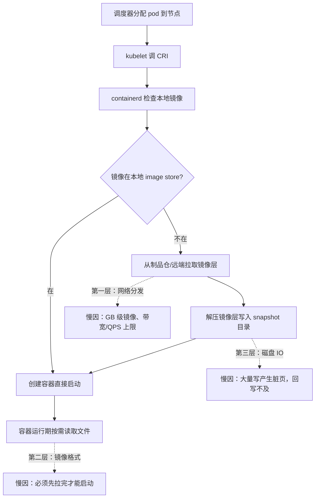
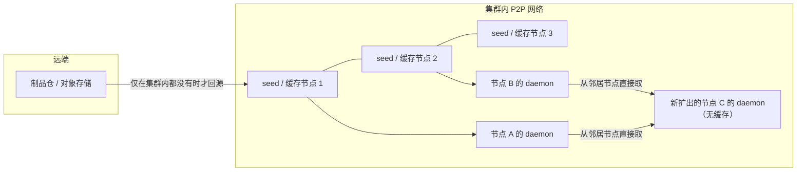
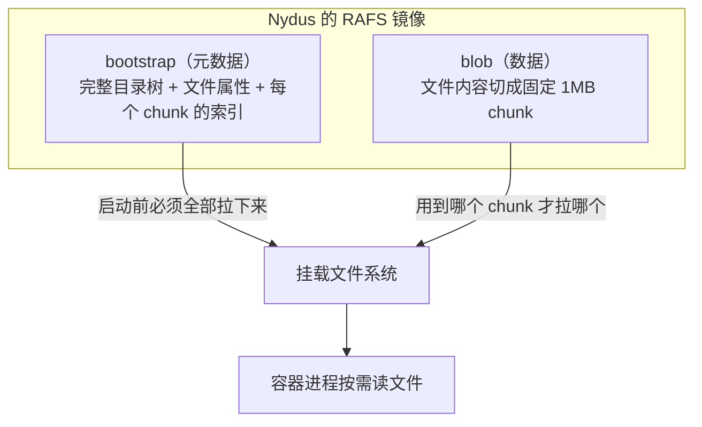
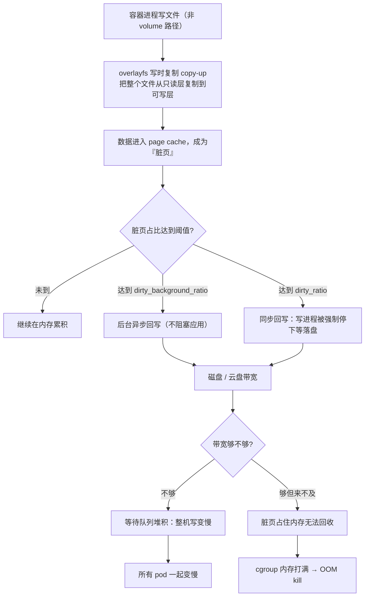
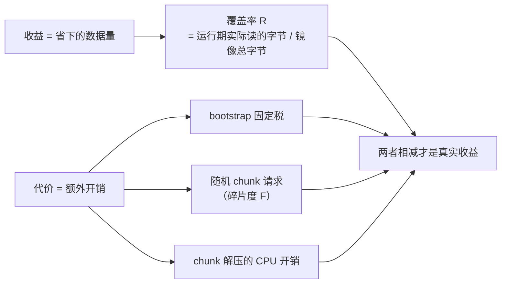
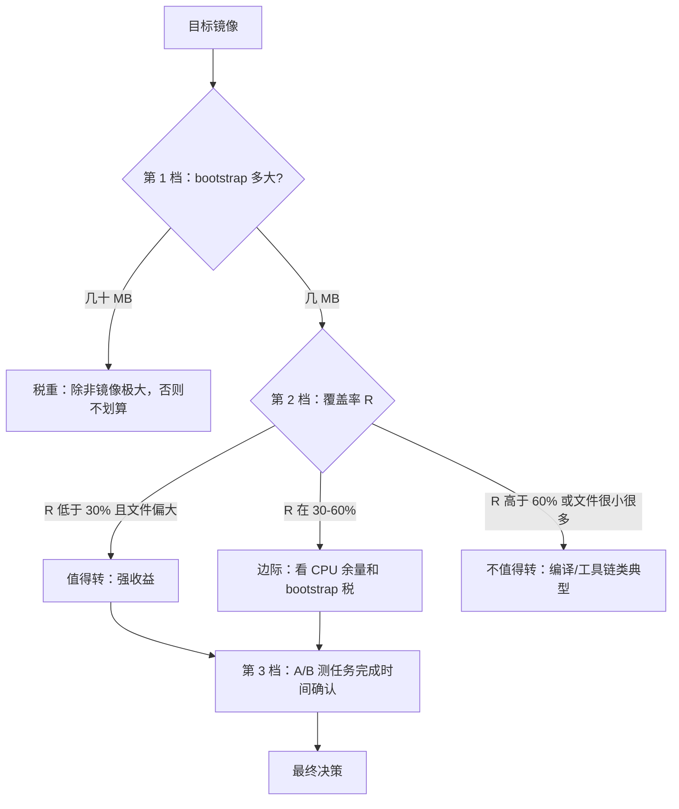

平台里有一条流水线集群，节点上跑着 GitLab Runner。原本一切正常，因为镜像在节点上缓着，job 起得很快。

后来给节点加了**动态扩缩容**——为了保证弹性，空闲的节点会被回收、需要时再扩出来。从此，镜像缓存就再也留不住了：新扩出来的节点是干净的，每一个 job 都要重新把镜像从制品仓拉一遍。

一句话概括这次两难：**拿到了扩容的灵活性，丢掉了启动速度**。这不是配置问题，是架构取舍——缓存依赖「节点长期存活」，弹性要求「节点随时生灭」，两者天然冲突。

之后花了一周定位和治理。回头看，慢的原因不止一个，它分散在三个完全不同的层面，每个层面的机制、手段、判断方法都不一样。

---

## 一、把「慢」拆成三层

先别急着优化。同一个「pod 起得慢」，可能卡在三个地方，用错手段等于白干。



| 层 | 主要症状 | 对应手段 | 我们做了什么 |
|---|---|---|---|
| 网络分发 | 大镜像从远端拉慢，打满制品仓带宽与 QPS | P2P 分发 | 引入 P2P 镜像加速 |
| 镜像格式 | 必须全量下载完才能启动，启动耗时与镜像大小成正比 | 懒加载（Nydus） | 引入 Nydus 镜像 |
| 磁盘 IO | 解压与写入产生脏页，回写来不及 → 内存压力或带宽打满 | 减少写量 / 限速 / 扩容带宽 | 云盘换高性能类型并加带宽 |

三层是**串联**的：P2P 让网络不再慢，瓶颈就转移到解压写盘；懒加载少拉了数据，但没解决写；磁盘带宽补上了，才发现真正的病灶在写量本身。

---

## 二、第一层：P2P —— 把「节点缓存」升级成「集群缓存」

### 2.1 为什么 P2P 正好治这个病

弹性的本质矛盾是「缓存依附于单个节点的生命周期」。P2P 换了个位置放缓存：**缓存不再属于某个节点，而是属于整个集群**。



- **每个节点一个 daemon**：拦截本机的镜像拉取请求，向调度侧询问「谁有这份数据」
- **若干个 seed / 缓存节点**：既做调度，也做回源与缓存，是整个网络的种子
- **新节点无需预热即可快速拿到镜像**：它自己没有缓存，但邻居有

这就把「弹性 = 缓存失效」这个死结松开了：新扩出来的节点从邻居或 seed 取数据，既不打满远端带宽，也不受制于单节点缓存寿命。

> 补充一个容易忽略的事实：节点上的镜像缓存（containerd 的 image store）依然存在且依然有用。P2P 不是替代它，而是当它缺失时提供另一条获取路径。

### 2.2 我当时的疑问：能不能干脆共享挂载一个缓存盘？

想法很自然——既然镜像缓存留不住，那就搞一块共享磁盘，所有节点都挂上，缓存只存一份。

**结论：镜像层这条路走不通**，但不是因为"没想到"，而是被文件系统语义卡死了。

容器要运行，镜像层必须通过 overlayfs 叠成一个根文件系统。而内核文档（`overlayfs.rst`）对 upperdir 有明确要求：

> The upper filesystem will normally be writable and if it is it must support the creation of `trusted.*` and/or `user.*` extended attributes, and **must provide valid `d_type` in `readdir` responses, so NFS is not suitable.**

网络文件系统（NFS 等）不满足这些条件，而且网络延迟会把容器启动拖垮。所以：

| 想共享的东西 | 能否共享挂载 | 原因 |
|---|---|---|
| 镜像层 / snapshot 目录 | 不能 | overlayfs upperdir 需要 xattr 与有效 d_type，NFS 不合适 |
| 工具链等只读普通文件 | 可以 | 普通文件语义，共享文件系统没问题 |
| 编译缓存（如 sccache） | 可以 | 但有副作用，见第七节 |

**正确的「共享缓存盘」形态不是共享文件系统，而是共享缓存服务**：盘只挂在一处（缓存服务上），所有节点通过网络向它取数据。P2P 的 seed 节点、制品仓的 proxy cache，本质都是这个形态。

### 2.3 缓存留不住，还能预热吗？

能，只是**预热的对象不是节点**。既然节点缓存必然丢，那就把缓存预热到「集群内那一层」——seed 节点上。常用手段按性价比排：

| 手段 | 做法 | 代价 |
|---|---|---|
| 预热进 seed 节点 | 用 P2P 的预热任务把常用镜像先拉进缓存节点 | 缓存节点要有足够磁盘与带宽；预热时机要与镜像发布联动 |
| 节点启动即预拉 | 实例创建后、注册 runner 前，并发拉常用镜像 | 拉取与节点初始化并行，不算纯额外耗时，但延长就绪时间 |
| 缩容时保护热节点 | 优先删除「缓存价值最低」的节点 | 需要自定义缩容选择器 |
| 镜像层复用 | base 层共享，只有工具链层变化 | 需要镜像构建规范约束 |

---

## 三、第二层：Nydus —— bootstrap 决定了一切

### 3.1 RAFS 的结构：把元数据和数据拆开

普通容器镜像是一层层 tar，要启动必须把所有层都拉下来解压。Nydus 换了个存法：**元数据与数据分离**。



- **bootstrap**：一份 metadata，内容是整棵目录树的 merkle tree——叶节点是文件（带数据 hash），内部节点是目录（带子节点 hash）。里面还有文件权限、属主、时间戳、软链，以及每个文件被切成了哪些 chunk。
- **blob**：真正的文件内容，按固定 **1MB** 切成 chunk，可以压缩（lz4/gzip/zstd）。

懒加载的关键在于：进程读到某个文件时，只要 bootstrap 知道这个文件的内容在哪几个 chunk 里，就可以只拉那几个 chunk。**没读到的文件，一个字节都不用拉。**

### 3.2 关键点：bootstrap 是「启动固定税」

这是理解 Nydus 收益的前提。

**bootstrap 必须全量下载，才能挂载文件系统。** 原因很直白：不知道目录树和文件索引，就无法响应任何 `stat`/`open`/`readdir`。所以无论容器实际只用几个文件，启动前都得先把这份元数据完整拿下来。

于是 Nydus 的成本结构变成：

```
启动耗时 ≈ [bootstrap 固定税（全量）] + [首次访问的 chunk 拉取]
```

而 **bootstrap 的大小随文件数增长**：每个文件要存一条 inode 记录，每个 chunk 要存一条索引（1GB 的文件 = 1000 条）。文件数越多，这份税越重。镜像里有几万个文件时，bootstrap 可能到几十 MB 量级——启动光拉元数据就要一段固定时间。

### 3.3 为什么编译场景收益反而最差

我们的实测结论是：**Nydus 不是所有场景都有收益**，编译类 job 尤其不明显，而后端服务类收益明显。

原因有两层，第二层常被忽略：

| 维度 | 后端服务 | 编译 job |
|---|---|---|
| 数据覆盖率 | 启动只加载少量文件，大部分镜像文件永不读 | 系统库、头文件、工具链大部分都会被用到 |
| 访问碎片度 | 少量大文件顺序读 | 海量小文件随机读（成千上万个头文件） |

碎片度这一层杀伤力更大：懒加载的最小单位是 1MB chunk，**每次访问一个几 KB 的头文件，都要发一次 1MB 粒度的数据请求**。成千上万次随机小访问变成了成千上万次网络往返 + 元数据查找，省下来的字节数被请求开销吃掉。

这也解释了另一个现象：一个很小的 sidecar 容器（比如流水线里的 helper 容器）反而收益明显——它启动频繁、镜像小、实际读的文件更少，bootstrap 税也轻。

### 3.4 与后续措施的联系：prefetch

Nydus 官方提供了缓解手段：**prefetch hints**。构建镜像时可以声明「哪些文件或目录需要预取」，运行时 daemon 会在后台提前把这些数据拉下来。

这直接和上面的 bootstrap 逻辑对应：

- bootstrap 决定「启动的固定税」，**prefetch 决定「运行期第一次读文件时不至于卡住」**
- 如果预取范围圈得接近全量，Nydus 就退化成了「慢速全量下载 + 多一层 FUSE/内核态开销」，不如老老实实用普通镜像
- 所以对编译类镜像，理性的选择是：要么不转 Nydus，要么只对确定会读的路径做半量预取

---

## 四、第三层：脏页回写 —— 磁盘为什么成了最后的瓶颈

网络和格式都优化之后，问题并没有结束。节点上并发跑一堆 job 时，会出现两种症状：**容器 OOM**，或**整机读写变慢**。一开始很容易误判成「应用内存泄漏」，其实它们是同一个机制的两面。

### 4.1 一次写操作，在系统里走了多远



几个关键机制：

| 机制 | 说明 |
|---|---|
| 脏页 = 已改未落盘 | page cache 里被修改但还没写到磁盘的数据 |
| 干净页可丢，脏页不可丢 | 干净页内存紧张时直接丢弃，下次从磁盘读回；脏页丢了就数据不一致，必须写下去才能释放 |
| 双阈值 | `dirty_background_ratio` 触发后台异步回写；`dirty_ratio` 触发同步回写，⚠️ 写进程被阻塞——这才是"整机变慢"的那一刻 |
| OOM 的真身 | 不是应用内存泄漏，而是脏页排不出去，把 cgroup 的内存额度占满 |

### 4.2 copy-up：一个被高估的嫌疑人

写只读层的文件时，overlayfs 会先把**整个文件**复制到可写层，再在副本上修改。改 1 个字节也要复制整个文件——如果被改的是几百 MB 的库文件，这个写放大非常惊人。

这也是我最初的判断：**写放大是磁盘压力的主因**。但实际情况推翻了它——我们的编译中间产物全部挂在 volume 上，而 **volume 里的写不经过 overlayfs，不触发 copy-up**。所以这条放大路径在我们场景里基本不存在。

这个纠偏很重要：它让排查方向从「减少 copy-up」转向了真正的两个源头：

| 写压力真实来源 | 说明 |
|---|---|
| 镜像解压 | 每个新节点首次拉 GB 级镜像，解压写入量约等于镜像解压后大小 |
| 业务写（编译产物等） | 并发 job 同时写 volume，一起争抢节点磁盘带宽 |

还有一个反直觉的耦合：**镜像拉得越快，解压写越集中**。P2P 把网络瓶颈解掉后，解压的写峰值反而更高——加速措施会把压力从网络推向磁盘。

### 4.3 为什么加带宽确实能缓解

把上面这条链路顺过来就清楚了：带宽提升 → 脏页更快变成干净页 → 不容易撞到 `dirty_ratio` 的同步阻塞线 → 写进程不被长时间阻塞 → 内存也能及时释放。

但这只是**把水管换粗**。真正的病灶是"写那么多"，而写量由镜像解压和业务写决定——所以它属于止血，不是根治。治本的顺序在第七节。

---

## 五、Nydus 该不该转：一套可落地的判定方法

这是最值得带走的部分。因为"转不转 Nydus"不能凭感觉，也不该只看官方 benchmark——要看自己的工作负载。

### 5.1 先明确两个维度



- **覆盖率 R**（决定省多少）：运行期实际读的字节 ÷ 镜像总字节。R 越低，懒加载省得越多。
- **碎片度 F**（决定代价多大）：读取的文件数相对读取字节数越高，说明越碎片化，请求开销越大。

### 5.2 三档测量（从最便宜到最准）

#### 第 0 档：静态粗筛（不跑 workload，几分钟）

把镜像导出，看文件大小分布和文件总数：

```bash
docker save img:tag -o /tmp/img.tar
tar -tvf /tmp/img.tar | awk '{print $3, $6}' > /tmp/files.txt
# 统计文件总数、平均文件大小、小文件占比
```

| 观察结果 | 判断 |
|---|---|
| 文件数超过 5 万，或平均文件小于 100KB | 碎片度不利，谨慎转 |
| 文件少、单文件大（几百 MB 级） | 有利，懒加载空间大 |

这一步只能筛掉明显不合适的，不能作为决策依据。

#### 第 1 档：bootstrap 实测（信息量最大的一次测量）

直接对目标镜像转换一次，**看生成出来的 bootstrap 有多大**：

```bash
# 用 nydusify 转换，观察输出的 bootstrap 文件大小
nydusify convert --source <image> --target <nydus-image>
```

因为 bootstrap 就是启动前必须全量下载的那部分，**它的体积直接等于你的固定启动税**。这一步不需要跑业务，却比任何估算都准。

| bootstrap 体积 | 判断 |
|---|---|
| 几 MB | 税很轻，值得继续评估 |
| 几十 MB | 税重，尤其对小镜像/短任务可能得不偿失 |

#### 第 2 档：动态精测覆盖率（最准的收益估算）

用**现有普通镜像**跑一轮典型 workload，观察它真正读了哪些文件、读了多少字节：

```bash
filetop 5        # bcc 工具：按进程看文件读写字节数 top N
vmtouch -v /     # 看进程退出后哪些文件驻留在 page cache
```

把读到的字节累计起来除以镜像大小，就得到真实的覆盖率 R。这一步得到的是**自己工作负载的真实画像**，比任何经验阈值都可靠。

#### 第 3 档：A/B 实测（终极判据，但极易测错）

⚠️ 这里有个陷阱，我第一次就差点踩进去：**不要测「容器 Running 的时间」**。

Nydus 是懒加载，容器 Running 时只拉了 bootstrap 和少量 chunk，这个指标会虚低得离谱，容易得出「优化了 80%」的假结论。

**必须测「任务真正完成的时间」**：编译跑完、服务返回首个正常响应。同一份工作负载、同样的数据，跑普通镜像 vs Nydus 镜像，比完成时间的 P50/P95。

### 5.3 判定矩阵



| 覆盖率 R | 文件特征 | 结论 |
|---|---|---|
| 低于 30% | 单文件偏大 | 强收益，值得转 |
| 30% - 60% | 中等 | 边际，需要 A/B 确认 |
| 高于 60% 或 | 海量小文件 | 不建议转（编译、工具链、构建类） |

### 5.4 补充：代价里还有一项常被忘掉

chunk 默认是压缩存储的（lz4/gzip/zstd），所以**拉下来的数据还要解压**。对 CPU 已经很紧的编译型负载，这部分开销也要算进账里。同时 Nydus 的 blobcache 默认没有淘汰策略（官方假设"只拉小部分"），长期运行要留意磁盘占用。

---

## 六、IO 治理的三个档位

聊到磁盘，最自然的反应是加带宽。但把手段按性价比排一下，顺序应该是：**减量 → 隔离 → 扩容**。


### 6.1 减量：让写少发生

| 手段 | 原理 |
|---|---|
| 编译缓存 | 命中缓存不重新编译，写量与 CPU 同时下降 |
| 镜像瘦身与拆分 | 减少解压写；按工具链拆多个小镜像比一个大而全更好 |
| 多盘分离 | 镜像存储与业务临时目录放到不同盘，两类 IO 物理隔离 |
| 控制单节点并发 | 同一时刻起太多 job，任何带宽都不够 |
| 减少镜像驱逐 | 磁盘吃紧导致镜像反复被删被拉，等于反复解压 |

### 6.2 隔离：把成本分账

容器默认**没有任何 IO 隔离**（cgroup 只管 CPU 和内存），一个 pod 写爆，全节点陪葬。cgroup v2 提供了几个不同的控制器：

| 控制器 | 语义 | 使用场景 |
|---|---|---|
| `io.max` | 速率上限（读/写字节每秒、IOPS），达到后 IO 被延迟，但允许临时突发 | 防止单个 pod 打满盘 |
| `io.weight` | 相对份额（1-10000），按 IO 时间成本而不是字节数分配 | 多个 pod 公平竞争 |
| `io.latency` | 延迟保护：给一组一个延迟目标，未达标则压制同级 peer | 保护关键服务 |
| `io.prio.class` | 优先级类（可把一组降为 idle） | 压制后台批处理 |

一个容易踩的细节：**`io.latency` 只在同级（peer）之间生效**，跨层级配置等于没配。它的实现也很有意思——不是简单限速，而是「队列深度限制」（最狠能压到一次只允许 1 个 IO）加「人为延迟注入」（swap 和元数据 IO 不能直接限，就允许发生但把成本记账到发起方）。

`io.max` 怎么用：cgroup v2 下直接写文件。

```bash
lsblk -o NAME,MAJ:MIN                       # 取设备号，如 259:0
# pod 的 cgroup 路径
cat /sys/fs/cgroup/kubepods.slice/.../cri-containerd-<id>.scope/io.max
# 写入限速：读 50MB/s、写 100MB/s、各 1000 IOPS
echo "259:0 rbps=52428800 wbps=104857600 riops=1000 wiops=1000" > io.max
```

K8s **没有原生 pod 级 IO 限速 API**，所以落地要靠自己：写个 DaemonSet 监听 pod 事件去写 cgroup 文件，或者用 NRI 插件在容器创建时注入。设值前先观测 `io.stat`，取 P95 的 2-3 倍当上限——限得太狠，编译会明显变慢。

### 6.3 一个必须知道的边界：脏页回写不一定记在「真凶」账上

这一条最反直觉。脏页是容器产生的，但回写是由**内核回写线程**发起的，而 cgroup writeback 的归因有硬性前提（内核文档 `cgroup-v2.rst`）：

> cgroup writeback requires explicit support from the underlying filesystem. Currently 仅在 ext2、ext4、btrfs、f2fs、xfs 上实现. **On other filesystems, all writeback IOs are attributed to the root cgroup.**

还有一条更细的：

> memory 是按 page 追踪的，而 writeback 是按 inode 追踪的。**多个 cgroup 同时写同一个 inode 的场景官方明确不支持好**，「a significant portion of IOs are likely to be attributed incorrectly」。

这意味着两件事：

1. 如果数据落在不支持的文件系统上（比如 NFS），这些回写 IO **全部记到 root cgroup**，对它做 `io.max` 没有任何意义
2. 如果多个容器并发写共享目录里的同一批文件（比如编译缓存放在共享目录），归因会大量出错，限速可能误伤别人、也可能漏掉真凶

我们目前的共享编译缓存就挂在 NFS 上，暂时没有看到瓶颈——因为还没做精细的 io 隔离，问题没有暴露。但如果将来要对编译 pod 上 `io.max`，这两条边界必须先处理掉。

### 6.4 观测：看「谁在受罪」，而不是「设备有多忙」

监控磁盘最常见的错误是盯 `%util`。但 `%util` 100% 只说明设备忙，**不代表有任务在挨饿**——设备可能正高效地服务所有请求。

PSI（Pressure Stall Information）才是"有人真的在等"的证据：

```bash
cat /proc/pressure/io              # 节点级
cat /sys/fs/cgroup/<pod>/io.pressure   # 容器级
```

```
some avg10=0.00 avg60=0.00 avg300=0.00 total=0
full avg10=0.00 avg60=0.00 avg300=0.00 total=0
```

| 字段 | 含义 |
|---|---|
| some | 至少有部分任务在等这个资源的时间占比 |
| full | 所有非空闲任务同时都在等的时间占比，此时 CPU 在空转，workload 处于 thrashing |
| avg10/60/300 | 三个时间窗口的趋势 |
| total | 累计停滞时间，专门用来抓短促的尖刺 |

PSI 还能直接做告警：往 `/proc/pressure/io` 写入 `full <停滞微秒> <窗口微秒>`，然后用 `poll()` 等唤醒即可，不用自己算阈值。

值得一提的是：给容器设了内存 limit，同时也"缩小"了它的脏页预算——因为 cgroup 里的脏页阈值是按被内存 limit 约束后的可用内存来算的。这也是为什么 `memory.high` 能间接压住脏页蔓延：超过软限后，内核会强制容器在自己的上下文里做回收。

---

## 七、复盘：三个被实测推翻的判断

这一节记我自己走错的路。写下来是因为它们比结论更容易重犯。

### 误判一：Nydus 无效是因为 dind

第一反应是怀疑「job 里用 docker-in-docker 拉镜像，绕过了节点的 containerd，所以 Nydus/P2P 不生效」。这个猜测在机制上成立，但被实测否掉了：**真正的原因是编译场景本身不适合懒加载**——大量系统库与头文件都会被读到，覆盖率太高，再叠加海量小文件带来的请求碎片。

教训：**先看 workload 的访问特征，再看链路配置**。机制上「可能」成立的解释，不等于「就是」这个原因。

### 误判二：copy-up 写放大是磁盘压力主因

写时复制确实会复制整个文件，写放大惊人，是个漂亮的嫌疑人。但我们的编译中间产物都挂在 volume 上——**volume 里的写不经过 overlayfs，根本不触发 copy-up**。这条路径在我们的场景里几乎不存在。

教训：**报出机制之前，先确认真实的写路径落在哪一层**。机制是真的，但可能不适用。

### 误判三：加带宽是解法

换高性能云盘、加带宽之后症状确实缓解了，这容易让人以为问题解决了。实际它只是把水管换粗：真正的写量来自镜像解压和并发业务写，而"拉得越快、解压写越集中"这个耦合，还会让加速措施反过来加剧磁盘压力。

教训：**缓解 ≠ 解决**。带宽能证明"瓶颈在磁盘"，但证明不了"病根在带宽"。

### 还有一个纯概念上的困惑

我曾经把「编译工具链不要进 runtime 镜像」理解成"运行时再安装工具链"，觉得那会很慢、不划算。其实那是多阶段构建（multi-stage build）的意思：构建阶段用重镜像编译，产出阶段从零开始只拷产物。

但更重要的是——**这条建议对我们不适用**。我们的 job 本身就是"要编译"，每个 job 都必须带工具链，不存在"瘦身掉工具链"的空间。所以工具链必须留在镜像里，只能接受它带来的 bootstrap 税和解压写。

---

## 一句话总结

**镜像拉取慢从来不是一个问题，而是三个：P2P 解决"从哪拿"，Nydus 解决"拿多少"，磁盘带宽解决"写得下"——而三者的收益都要用自己 workload 的真实画像去算，不能背结论。**
