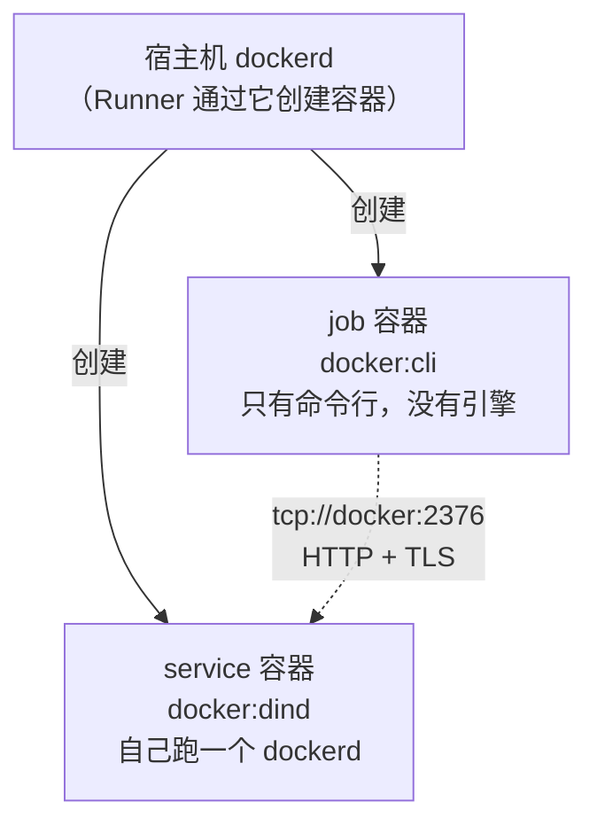
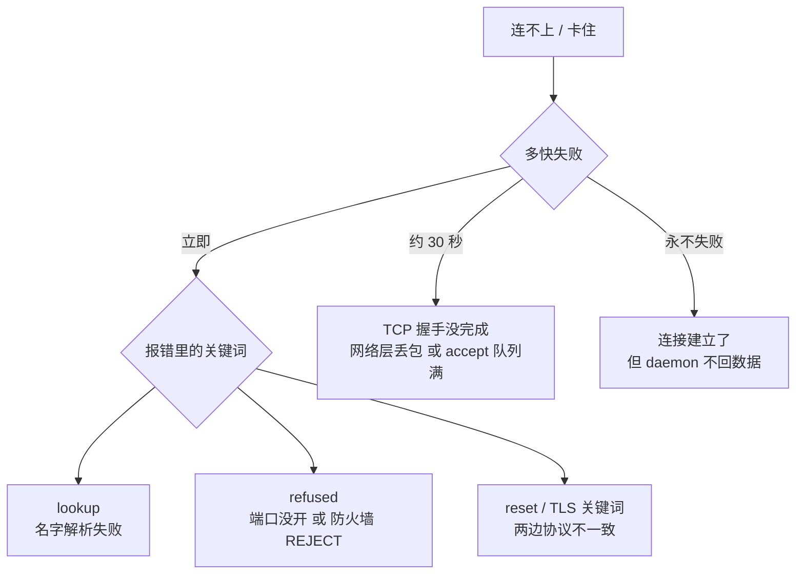

我做过 Docker in Docker 的 GitLab CI job，构建镜像能跑通，流水线是绿的。但如果有人问我「它是怎么工作的」，我只能给出三个凭印象的答案：

| 我原来的理解 | 判定 |
|---|---|
| 把 docker 引擎的端口映射进了容器 | 错 |
| 容器里调 docker，实际用的是另一个 daemon | 对 |
| service 方式挂在 job 上 | 对，但关系搞错了 |

第二条是关键，也是我一直没往下想的地方。第三条我以为是「嵌套」，实际是「平级」。

真正翻案是在读源码的时候：GitLab Runner 给 service 容器建 HostConfig 的函数里，压根没有 `PortBindings` 这个字段。**全程没有端口映射。**

那 `docker` 这个名字是从哪来的？顺着这条线挖下去，会一路挖到内核的 TCP 协议栈。

---

## 一、先纠正一个误解：dind 根本没有端口映射

dind 的官方说法是「Docker-in-Docker」，听起来像把 docker 装进容器。这个命名本身就在误导人。

实际跑起来，机器上是三个东西、两个互不相干的 daemon：



关键在于 job 容器和 service 容器是**平级的兄弟**，不是父子。两个 dockerd 之间也没有任何关系——service 容器里那个是全新的，有自己的 `/var/lib/docker`，job 一结束就跟着销毁。

job 容器里到底有什么？只有一个可执行文件。`docker build` 敲下去的时候，**job 容器里没有任何东西在构建**，它只是把一条 HTTP 请求发了出去。

> **一句话本质**：dind 不是「把 docker 装进你的容器」，而是起第二个 dockerd 当独立服务，job 容器里的 `docker` 只是个遥控器。

理解这一点之后，剩下的问题就变成了：遥控器怎么找到那个 daemon。

---

## 二、`docker` 这个名字从哪来

如果你在 dind 的 job 里执行 `getent hosts docker`，会拿到一个 IP；但执行 `nslookup docker`，大概率失败。

这不是环境有问题，而是**它本来就不在 DNS 里**。

Runner 建 job 容器的时候，把 service 容器的 IP 拼成 `docker:172.17.0.x` 这种形式，塞进 job 容器的 `ExtraHosts`。落到容器里，就是 `/etc/hosts` 的一行记录。

只有当 `network_mode` 配成自定义网络（对应 `FF_NETWORK_PER_BUILD` 这个特性开关）时，才会走另一条路：建一个 user-defined 网络，给 service 容器挂上 DNS 别名，由 Docker 内嵌的 DNS 服务器解析。

| | 默认模式 | 自定义网络模式 |
|---|---|---|
| 名字存在哪 | job 容器的 `/etc/hosts` | 网络的 DNS 别名表 |
| 谁负责解析 | 系统 hosts 文件 | Docker 内嵌 DNS |
| IP 什么时候确定 | 建 job 容器的那一刻，写死 | 每次查询时解析 |
| 迁移性 | 弱 | 强 |

这张表最右边那列值得咂摸。默认模式下，**IP 在建 job 容器时就写死了**。如果 service 容器之后重启拿了新 IP，那条 hosts 记录就永久指向一个不存在的地址——而且不会报任何错，只会让你一直等。

顺带澄清另一个常见误读：docker:dind 镜像里 `EXPOSE 2375 2376` 那两行，只是元数据。它被 Runner 用来做健康检查（Runner 会专门起一个 helper 容器轮询端口），**不是对外发布端口**。

> **判断力**：一个名字能被解析，不代表它走的是你以为的那条路。`getent hosts` 走的是系统真实的解析链（会读 hosts），`nslookup` 只问 DNS——两者的差异本身就是线索。

---

## 三、`docker build` 到底在跟谁说话

这一层最容易想当然。看起来 docker 是一体化的工具，实际上它和 dockerd 之间是标准的客户端—服务端结构，中间跑的是**纯 HTTP**。

我做了一次实证：写一个假的 dockerd（只实现几个接口），用真的 docker CLI 去连，把服务端收到的请求打出来。

```
>>> HEAD /_ping
      Host: 127.0.0.1:2375
      User-Agent: Docker-Client/28.5.1 (linux)
>>> GET /v1.51/version
      Host: 127.0.0.1:2375
```

两条都是标准 HTTP，没有任何私有协议。

第一条 `HEAD /_ping` 值得单独说——它是**版本协商**。服务端会在响应头里回一个 `Api-Version`，CLI 据此决定后续所有请求的 URL 前缀。这也是为什么新版 CLI 连老版本 daemon 通常还能用：它先问一句「你会说哪个版本」。

完整的链路是六步：


推到底，`docker build` 无非是一次 `POST`，`docker run` 是 `POST .../containers/create` 加 `/start`。

既然只是 HTTP，那**没有 docker CLI 也能操作 daemon**：

```
$ curl -D- http://127.0.0.1:2375/_ping
HTTP/1.1 200 OK
Api-Version: 1.51
```

这个认知的迁移价值在于：换任何环境，你只需要三样东西——**`DOCKER_HOST`（去哪）、一份能验过的证书（怎么信任）、一条能通的 TCP（能不能到达）**。命令本身一行都不用改。Docker executor 换 K8s executor、换远程 daemon、换 WSL 里的本机 socket，变的只有这三样。

---

## 四、卡住的时候，到底卡在哪一层

前面三章讲的是它正常工作时长什么样。真正值钱的是它不正常的时候。

先立一条元规则：

> **先读现象，再选工具。现象里的「耗时」和「有没有报错」，本身就是分类器。**

我实测了六种失败，全部记录在同一台机器上：

| 场景 | 耗时 | 报错特征 |
|---|---|---|
| 名字查不到 | 立即 | `lookup xxx ... server misbehaving` |
| 端口没人在听 | 24 ms | `Cannot connect to the Docker daemon` |
| 防火墙 REJECT | 27 ms | 和上一行逐字相同 |
| 网络 DROP / IP 不可达 | 32 s | `dial tcp x.x.x.x:2376: i/o timeout` |
| TCP 通了但 HTTP 不回 | 永不超时 | 一个字都不报 |
| 协议对不上 | 立即 | `connection reset` 或 `first record does not look like a TLS handshake` |

从这张表能读出三条铁律。

### 铁律一：服务没起来是秒拒，不是卡住

很多人（包括我）会把「连不上」笼统归成「网络不通或者服务没起来」。但这两件事在现象上是**互斥**的。

端口没有监听时，内核对来的 SYN 直接回一个 RST，客户端立刻知道「这里没人」。**24 毫秒就结束了。**

能让你等 32 秒的，恰恰是「包发出去石沉大海」——连拒绝都懒得给的那种。

### 铁律二：端口没开和防火墙 REJECT，客户端分不出来

24ms 和 27ms，报错文本一模一样。因为物理层面本来就一样：**内核回的都是 RST**。

所以这两个只能进对端看（`ss -ltn` 有没有在听、iptables 有没有 REJECT 规则）。反过来，**超时反而不用进对端**——你可以直接从客户端断定「包没被处理」。

### 铁律三：不报错的那个最难排

六种失败里，只有「TCP 通了但 HTTP 不回」会安静地卡住。**骂人的错误好排，沉默的错误难排。**

把这六种失败整理成一张判断图，就是排查时最该先走的一遍：



### 再往下：谁在回包

到这一步，问题从应用层掉进了内核。

我把监听进程 `kill -9` 掉，然后发连接、同时抓包：

```
15:47:07.394652 IP 127.0.0.1.56992 > 127.0.0.1.2382: Flags [S]
15:47:07.394666 IP 127.0.0.1.2382 > 127.0.0.1.56992: Flags [R.]
```

这两行相隔 14 微秒。而此刻 2382 端口上**已经没有任何进程了**。

那 RST 是谁发的？内核。

进程调 `listen()` 时向内核注册一个 socket；进程一死，内核把它从监听表里摘掉。新来的 SYN 查无匹配，内核就按 TCP 协议回一个 RST。这是协议规定，跟应用层一点关系都没有。

这就解释了「秒拒」的全部机制：**内核在替已经死掉的进程拒绝。**

### 反过来，卡住的机制同样在内核

只要进程调过 `listen()`，内核就替它做这些事：回 SYN-ACK、完成三次握手、把连接放进 **accept 队列**，然后等进程调 `accept()` 来取。

**进程不来取，连接就永远躺在队列里，一个字节都不会回。**

我实测了一个 `listen(1)` 之后永不 accept 的进程：

| 第几个连接 | connect 耗时 | 结果 |
|---|---|---|
| 第 1 个 | 0.000274s | 握手成功（内核代劳），卡在响应 |
| 第 2 个 | 0.000270s | 握手成功，卡在响应 |
| 第 3 个 | 0.000000s | 握手都建不起来，撞超时 |

此时 `ss -ltn` 显示 `LISTEN Recv-Q=2 Send-Q=1`——accept 队列满了。

**这里藏着我之前漏掉的第三种超时成因。**

队列满的时候，内核怎么处理取决于一个开关：`/proc/sys/net/ipv4/tcp_abort_on_overflow`，默认值是 `0`，意思是**静默丢弃 SYN，不回 RST**。

于是客户端看到的还是超时——**和网络 DROP 一模一样**。

所以「连接超时」其实有两个完全不同的病因：

| 病因 | 怎么区分 |
|---|---|
| 网络层丢包、IP 陈旧 | `tcpdump` 看 SYN 有没有出网卡 |
| 服务端 accept 队列满，进程不取连接 | `ss -ltn` 看 `Recv-Q` 是否持续非零 |

这两种在客户端看到的画面完全一致。**唯一的分辨办法，就是进对端看队列。**

顺便说一个容易看错的地方：`ss` 里的 `Recv-Q` 在两种状态下含义完全不同。

| 状态 | Recv-Q | Send-Q |
|---|---|---|
| LISTEN | 排队等着被 accept 的连接数 | backlog 上限 |
| ESTABLISHED | 已收到但应用没读走的字节数 | 已发出、对端未确认的字节数 |

两个都持续非零，说明进程还活着（内核还在替它收连接），但业务线程全卡死了。它不是拒绝你，是顾不过来。

### 工具的选择比命令的数量重要

这一步我踩过坑。

对同一个「TCP 通但 HTTP 不回」的目标，两个工具给出完全相反的暗示：

| 场景 | `nc -zv` | `curl --max-time` |
|---|---|---|
| 服务正常 | succeeded，18ms | HTTP 200，55ms |
| 网络 DROP | timed out，4010ms | 退出码 28 |
| 端口没开 | failed，8ms | 退出码 7 |
| TCP 通但 HTTP 不回 | ⚠️ succeeded，8ms | 退出码 28，6014ms |

**`nc` 会骗你。** 它只做 TCP 握手，握手成功就报成功，根本不管对面会不会说话。

而 `curl -v` 会把「卡住」翻译成「卡在哪一行」：

```
*   Trying 127.0.0.1:2377...
* Connected to 127.0.0.1 (127.0.0.1) port 2377     ← TCP 通了
> GET /_ping HTTP/1.1                                ← 请求发出去了
* Operation timed out after 6002 milliseconds with 0 bytes received   ← 卡在这
```

最后那行 `0 bytes received` 一次性说清三件事：不是网络问题、不是协议问题、是**对方收到请求后一个字节都没回**。

还有一个不太为人知的杀招：`curl -w` 里的 `time_connect`。

在 DROP 场景下它是 `0.000000`，连接从未建立；在半死 daemon 场景下它是 `0.0005`，连接毫秒级就建好了，卡在响应。

两种都是退出码 28、都是超时，**只有这一列能分开它们**。

> **判断力**：`ping`、`nc`、`telnet` 只回答「通不通」，一旦通了就闭嘴。`curl -v`、`openssl s_client`、`ss`、`tcpdump` 才能回答「卡在哪一步」。排查工具的选择标准不是覆盖面，而是它能不能把「卡住」拆成「卡在第几行」。

---

## 五、它为什么正在退出舞台

如果说 dind 的设计有什么让人佩服的地方，那是它用「起第二个 daemon」这个笨办法，换来了**每个 job 一个干净的构建环境**。这个取舍在当年是对的。

但代价也很明确，三条：

| 硬伤 | 后果 |
|---|---|
| 必须 privileged | 等于把宿主机 root 交出去，安全上过不去 |
| 每次 job 全新 daemon | 构建缓存结构性失效 |
| 嵌套存储 | overlay2 套 overlay2，每层读写穿透两层 |

第二条是最致命的，也是最容易被忽略的。

它的表现不是「慢一点」，而是**结构上就不具备跨 job 复用构建层的能力**。你的 `RUN npm install` 那一层昨天跑过，今天还得从零跑一遍，因为新 job 里的 `/var/lib/docker` 是空的。

**缓存的代价比 CPU 贵得多。** 这才是大厂抛弃它的核心理由。

于是有了四代演进：


第二代（把宿主的 `/var/run/docker.sock` 挂进容器）解决了缓存问题，但把「容器逃逸」变成了「直接就是宿主 root」，比 dind 更危险。

第三代用用户体验上的妥协换掉了 daemon：Kaniko 在用户态直接解包镜像层，不需要 daemon、不需要特权，可以在普通 K8s 集群里构建。

真正的分水岭是第四代。**BuildKit 在 2020 年引入了远程缓存导出**——把每一层的缓存存到共享存储，下次构建再拉回来。

AWS 在支持这个能力时的一句话点破了要害：

> GitHub Actions 或 GitLab CI 这类平台每次构建都用临时计算资源，所以它们**无法积累并使用本地缓存**。

到此为止，dind 存在的最大理由——隔离——被另一个层次的方案拿走了，而它最大的缺陷——缓存——被远程缓存补上了。

**顺便记一个时代注脚**：Kaniko 已于 **2025 年 6 月**被 Google 归档，最后版本停在 v1.24.0。现在有两个社区 fork 在续命，GitLab 也已弃用它的官方支持。如果你的流水线里还写着 `gcr.io/kaniko-project/executor`，那是个收不到安全补丁的镜像。

> **判断力**：一个方案的死因，往往不在它擅长的地方，而在它结构性缺失的地方。dind 擅长隔离，它死在缓存上。

---

## 六、现在主流怎么做

理解 BuildKit 只需要一个前提：**构建不在客户端跑。**

```
buildctl（客户端）  ──gRPC──▶  buildkitd（守护进程）
```

客户端只负责发上下文、收日志；拉基础镜像、跑 `RUN`、组装层，全在 daemon 那边。**这个分离是后面所有玩法的基础。**

于是有了四种部署形态：

| 形态 | 代表 | 适合 | 代价 |
|---|---|---|---|
| 一次性 builder | K8s driver、dind | 安全要求高 | 冷启动，缓存必空 |
| 常驻共享 buildkitd | remote driver | 企业主流 | 资源争抢、缓存投毒面 |
| 无守护进程 | Buildah | OpenShift 系 | 跨机缓存仍需外置 |
| 语言级构建器 | ko / Jib | 纯 Go / Java | 只适用对应语言 |

最后一种被严重低估：`ko` 跑完 `go build` 直接把二进制组装成镜像，`Jib` 按依赖、资源、类分层——**都不需要 daemon、不需要特权**，还能交叉编译做多架构。对纯 Go/Java 的项目，这能把大部分镜像彻底移出「特权构建」的问题域。

这里有个需要破除的迷思：**「rootless」不等于什么都不用放宽。** 在 K8s 里跑 rootless BuildKit，除了用户不是 root，仍然需要把 seccomp 和 AppArmor 设成 `Unconfined`。而且如果宿主机没有配好 `newuidmap` 和 subordinate IDs，它能启动、但解不开基础镜像——测试必须用真实镜像，空跑通过不代表可用。

### 缓存不是一个东西，是三层

这是我在这一轮里最大的认知更新。

| 层 | 是什么 | 进镜像 | 随 `--cache-to` 导出 |
|---|---|---|---|
| 镜像层缓存 | 构建出来的每一层 | 是 | 是 |
| cache mount | 包管理器目录，如 `/root/.npm` | 否，永远不进 | ❌ 永远不导 |
| 远程导出 | 把第一层存到 registry 或对象存储 | — | 就是这一层 |

**cache mount 这一层最容易被忽略，却最影响速度**：改一行代码重跑，`npm install` 那一步虽然层缓存没命中，但包不用重新下载。

而它的限制也很硬——官方文档写明：cache mount 存在 builder 的本地存储里，**不随 `--cache-to` 导出，也不会被 `--cache-from` 恢复**。

这意味着：一次性 runner 上，它每个构建都是空的。逻辑上完全自洽——你的构建环境每次都是新的，那个本地目录当然也不存在了。

### 并发会冲突吗

会，而且官方给了三档参数来管：

| 取值 | 行为 |
|---|---|
| `shared`（默认） | 允许多个写者并发使用，不保证一致性 |
| `private` | 有多个写者时，各给一份新副本 |
| `locked` | 第二个写者暂停，等第一个释放 |

我实测了三种并发写策略，两个「构建」同时往同一个文件写 4MB：

| 策略 | 结果 |
|---|---|
| 直接覆盖写 | 内容交错，损坏 |
| 临时文件 + 原子 rename | 完整 |
| flock 独占串行 | 完整 |

那**为什么默认的 `shared` 是安全的**？

因为现代包管理器自己就用了「临时文件 + 原子 rename」那套。npm、pip、Go module cache 都是内容寻址的：包按内容哈希命名，先写临时文件，最后原子改名。两个构建同时下同一个包，各写各的临时文件，最后谁先到谁生效，**但文件永远是完整的**。

apt 就不行。官方文档专门举了它的例子，理由写得很直白：*Apt needs exclusive access to its data*——apt 会**原地修改索引文件**，没有原子写保护。所以 apt 的缓存必须 `sharing=locked`。

> **判断标准只有一条**：看这个包管理器会不会「原地修改」文件。会，就用 `locked`；不会（内容寻址 + 原子写），`shared` 就够。

还有一句官方提醒值得抄下来：

> 你的构建应该在缓存目录是**任意内容**的情况下都能工作，因为另一个构建可能覆盖它，GC 也可能清理它。

**所以 cache mount 只能用来提速，绝不能存「必须存在」的中间产物。**

### 一个绕不开的物理限制

所有构建的缓存读写，最后都打在 buildkitd 所在的那块盘上。

这台机器的磁盘是机械盘，我量了一下：

| 场景 | 结果 |
|---|---|
| 顺序写 200MB | 524 MB/s |
| 2000 个 4KB 小文件 | 63.5 MB/s |
| 单个写 50MB | 137 MB/s |
| 4 个并发各写 50MB | 总吞吐 135 MB/s |

最后一行是重点：**抢带宽比 0.99 倍。4 个构建同时跑，总带宽一点没涨，每个只拿到原来的四分之一。**

并发不提高总吞吐，它只是把蛋糕切小。

还值得注意的是第二行——4KB 小文件只有顺序写的八分之一。而 npm、pip、Go module 的缓存目录，**恰好全是海量小文件**。

这和我之前那篇《镜像拉取慢的三层定位》里踩的是同一堵墙：**镜像层和缓存层，最后都撞在「小文件 IOPS」上。** 一个是拉下来时解包，一个是构建时读写，病根是同一个。

这也解释了为什么共享 buildkitd 的方案有物理天花板。它不是配置问题，是磁盘只有那么多带宽。想扩只能换更快的盘、或者把 builder 分片、或者用 cgroup 给每个 builder 限 `io.max` 防止一个构建把盘打满饿死别人。

---

## 一句话总结

dind 的全部秘密就一句：**你那台容器里没有引擎，只有一个遥控器**——名字来自 `/etc/hosts` 的一行记录，请求走的是普通 HTTP，打的是另一个容器里的 daemon。

而排障的全部方法也就一句：**先量耗时、再看有没有报错**——秒拒是内核替死掉的进程拒绝，卡住是内核替卡住的进程收了连接却没人来取，内核永远在尽职，所以沉默的那一种最难排。
