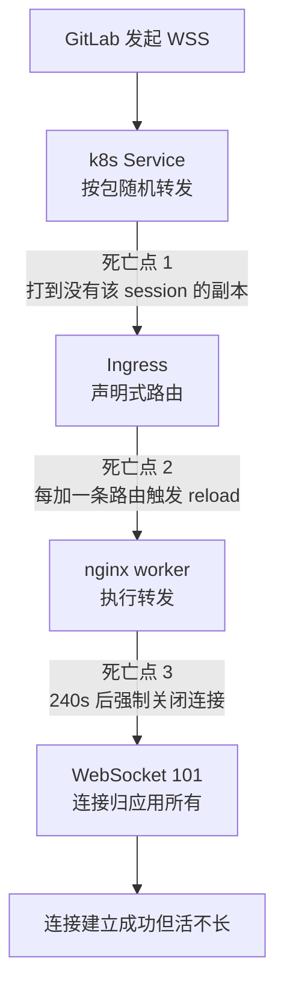
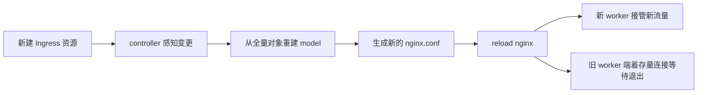
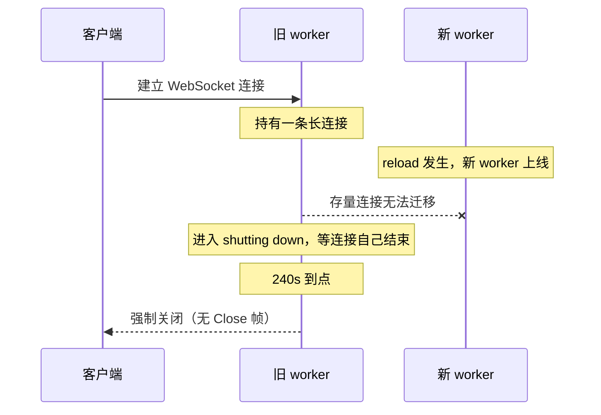

平台里有一批 Runner 跑在 K8s 上，job 跑在临时 Pod 里。开发者遇到环境类问题——依赖没装对、权限不对、路径找不到——只能自己本地复现，或者把日志贴出来让别人猜。

所以想做一个"直接进 job 环境"的在线终端：点一下，浏览器里出来一个 shell，就是那个 job 正在跑的容器。

第一版做出来，连不上。

第二版改完，能连上了，但每次坚持 3 到 5 分钟就掉线，而且**极其规律**。

"规律"这个词后来成了整个定位过程的起点：能按时按点复现的故障，通常不是代码逻辑写错了，而是某个东西到点做了某件事。

一句话概括这次踩坑：

> 这不是一个 bug，是**两个设计前提的叠加**——k8s 的 Service 只会按包转发，nginx 的配置模型只能换进程。而"有状态的长连接"跟这两条都不兼容。



---

## 一、先把问题拆成两个，别混着解

「终端连不上」听起来像一件事，实际上是两件互相独立的事：

| 问题 | 它在问什么 | 症状长什么样 |
|---|---|---|
| **路由问题** | 这条连接该打到哪个副本 | 一连就失败，立刻报错 |
| **寿命问题** | 这条连接能活多久 | 用了一会儿才断 |

它们由**完全不同的机制**决定，用**完全不同的手段**解决。

把两者混在一起，最常见的后果是：明明是进程被回收了，却一直在调负载均衡的超时参数。症状都是"断了"，但根因差着好几层。

下面四层，前两层管路由，后两层管寿命。

---

## 二、第一层：k8s Service —— ClusterIP 从未在网络上存在过

### 2.1 为什么这里必须先讲清楚 session 在哪

Runner 在 K8s 里的形态是**多个 manager 副本**，每个副本都向 CI 服务端要 job。

拿到 job 的那个副本负责：创建 job Pod、执行脚本、回传日志，**并且向服务端上报一条 session 信息**——其中包含"到这个副本来找这个会话"的地址。

关键在于：**这个 session 只活在拿到它的那个副本的进程内存里。** 别的副本没见过它，自然也没有它。

```
副本A 拿到 job-42  → session_42 存在于 A 的内存
副本B、C            → 不认识 session_42
```

而对外，这三个副本共用一个 Service。

### 2.2 ClusterIP 是一块假地址

很多人下意识以为 Service 就像一台反向代理服务器，有个 IP 在监听。

不是的。

```
ClusterIP            = 一块虚拟地址，不属于任何网卡，ping 不通，集群外不可达
kube-proxy 的 iptables 规则 = 真正干活的东西
Endpoints            = 规则里的候选后端名单
```

kube-proxy 在每个节点上写的规则大致长这样（iptables 模式，概率递减实现等权）：

```
KUBE-SERVICES                      # 匹配「目的 IP == ClusterIP」的包
   └→ KUBE-SVC-X7F2K               # 这个 Service 的选后端逻辑
        ├─ 33% 概率 → KUBE-SEP-AAA   # -m statistic --mode random --probability 0.333
        ├─ 50% 概率 → KUBE-SEP-BBB
        └─ 100%     → KUBE-SEP-CCC
每个 KUBE-SEP-* 的动作：DNAT --to-destination <PodIP>:<Port>
```

注意三个字：**随机的**。

它不看"这个请求要干什么"，也没有"上次给了谁"的记忆，它只看包。

**所以第一版为什么连不上**：session_42 只在副本 A 上，而 Service 会把它随机分给 A、B、C 中的任意一个。三分之二的概率，连接落到一个根本没有这个会话的副本上，直接被拒绝。

### 2.3 conntrack：选一次，定终身

这里有个容易误解的点：**不会"中途跳到别的副本"**。

```
TCP 建连（SYN）→ 匹配随机规则 → DNAT 改写目标 → conntrack 记下表项
                                                  ↓
                            表项：(原目标 ClusterIP:Port → 实际 PodIP:Port)
之后这条连接的所有包 → 直接查 conntrack → 按表项走 → 不再过随机规则
```

**后端是在建连那一刻定下来的，之后整条连接都跟着走。**

由此可以推出两条很实用的判据：

| 结论 | 排障时的用法 |
|---|---|
| 后端在连接生命周期内固定 | 如果是"连上就失败"，怀疑**建连时选错** |
| 重连 = 新 conntrack 条目 = 重新抽签 | 如果是"用了一会儿才断"，那是另一回事，跟路由无关 |

### 2.4 顺手排除一个看起来很对的方案：客户端亲和

k8s 的 Service 确实支持会话保持：

```yaml
spec:
  sessionAffinity: ClientIP
  sessionAffinityConfig:
    clientIP:
      timeoutSeconds: 10800
```

看起来正是为这种场景准备的。但这里有个**粒度错位**：

| | 按什么划分 |
|---|---|
| Service 的亲和 | **客户端源 IP**（你从哪来）|
| 实际的需求 | **会话标识**（你要找谁）|

而发起连接的客户端是**少数几个固定来源**（CI 服务端）。所有 WSS 请求都来自同样几个 IP，按源 IP 哈希的结果是：**全部锁死到同一个副本**。

那个副本只持有它自己那几个 session。于是：

```
1/N 命中，其余全失败
更糟的是——重试也没用，因为哈希结果不变，永远回到同一个错副本
```

**同样是 1/N 的成功率，随机转发至少还允许重试碰运气；源 IP 亲和把"概率性失败"升级成了"确定性失败"。**

### 2.5 想精确打到某个副本：headless + 手工 Endpoints

既然随机不行、亲和也不行，就需要让路由**真正指向某个具体副本**。

Ingress 的 backend 只能指向 Service，不能直接写 Pod IP。所以要中间加一层「只包含一个后端的 Service」：

```
Headless Service（clusterIP: None）
   + 手工 Endpoints { IP: <目标 Pod IP>, Port: <端口> }
   → controller 读 Service → Endpoints → upstream 里只有这一个后端 → 点对点
```

`clusterIP: None` 的 Service 不会分配虚拟 IP，kube-proxy 不为它写任何规则，DNS 直接返回后端列表。配合**不带 selector 的手工 Endpoints**，可以把流量精确指向任意地址，甚至集群外的地址。

这一版做出来，连接通了。

但代价也埋在这里：

- **每个 job 需要三件套对象**：Ingress + Service + Endpoints
- **Pod IP 是会变的**：副本重建后，账本里的地址就指向一个不存在的 Pod
- 而 controller 的 model 是**全量重建**的，对象越多，每次重建越重

---

## 三、第二层：Ingress —— 一份声明，和一场必然的重载

### 3.1 Ingress 不转发任何东西

这是最多人搞错的一层：

```
Ingress 资源        = 一份 HTTP 路由声明（host/path → 后端），只是 YAML 记录
ingress-controller  = 消费者：监听声明 → 翻译成 nginx.conf → 让 nginx 生效
nginx               = 真正转发的地方
```

**Ingress 本身没有任何转发能力。** 写一个 Ingress 对象，只是往 controller 的"配置源"里加了一行。

所以"动态创建 Ingress 做路由"这个动作的真实含义是：

> 你在**不断改写一个需要被重新翻译成配置文件的输入**。而重新翻译的过程，就是 reload。



这一版的问题，就埋在这个 reload 里。

---

## 四、第三层：nginx worker —— 240 秒的死刑

### 4.1 配置读死在进程启动时

nginx 的进程模型很简单：

```
        ┌──────────┐
        │  master  │   只做管理：读配置、管 worker、处理信号，不处理连接
        └────┬─────┘
     ┌───────┼───────┐
   ┌─▼─┐   ┌─▼─┐   ┌─▼─┐
   │w1 │   │w2 │   │w3 │   真正干活：accept 连接、跑各自的事件循环
   └───┘   └───┘   └───┘
```

关键事实：**配置是 worker 启动时读取并编译进内存结构的**（路由表、upstream 列表）。worker 运行期间不会重读配置文件。

所以"能不能不改配置、只更新后端列表"这个需求，**OSS nginx 自己做不到**。这是架构决定的，不是版本问题——Envoy 用 xDS、HAProxy 用 runtime API 都能运行时更新 upstream 而进程不动，nginx 的原生模型里没有这个概念。

### 4.2 reload 不是重启，是新老并存

```
1. controller 生成新 nginx.conf
2. 向 master 发 HUP 信号
3. master 校验新配置 → 起新 worker（读新配置）→ 新 worker 开始 accept 新连接
4. master 告诉旧 worker：**停止 accept 新连接，但把手上的存量连接服务完**
   ↓ 此刻两条时间线并行：
   · 新 worker 接管所有新流量
   · 旧 worker 进入 "worker process is shutting down"，端着存量长连接继续跑
5. 存量连接陆续结束 → 旧 worker 变空 → 自然退出
6. **只要还有一条连接不放，旧 worker 就死不掉**
```

正常 HTTP 场景下这个设计很优雅：请求-响应几毫秒就结束，旧 worker 很快就空了。

**但长连接不是。** 一条 WebSocket 只要用户还开着终端，就不会自己结束。

### 4.3 为什么连接搬不走

旧 worker 为什么不能把连接"交接"给新 worker？

```
一条 TCP 连接的 fd 属于某一个 worker 的 epoll 实例
协议状态机、读写缓冲区都在那个 worker 的进程内存里
   ↓
连接没法在进程之间搬家
```

这里有个容易被混淆的对照：**数据可以复制，连接不能复制。**

- session 数据是一段字节，可以放 Redis，任何进程都能读 → 所以"状态外置"能解决**路由**问题
- TCP 连接是内核里的一个 socket 对象（四元组 + 缓冲区 + 状态机），只在"这一个内核"里存在 → 所以"连接迁移"解决不了

这就决定了：**graceful shutdown 在长连接面前天然无解**。旧 worker 只有两条路——等它自己结束，或者强制结束它。

### 4.4 到点处决：worker_shutdown_timeout

nginx 官方对 `worker_shutdown_timeout` 的定义：

> Configures a timeout for a graceful shutdown of worker processes. **When the time expires, nginx will try to close all the connections currently open** to facilitate shutdown.

而 ingress-nginx 把这个值默认设成了 **240 秒**。



**完整因果链**：

```
每个 job 建一条新路由（Ingress 资源）
   → controller 重建 model → reload
   → 旧 worker 进入 graceful shutdown，端着你的 WebSocket
   → 240s 到点 → 强制关闭它身上所有还开着的连接
   → 长连接被杀
```

### 4.5 为什么"3 到 5 分钟"这么准

断开时刻的公式是：

**断开时刻 = 最近一次 reload 的时刻 + 240 秒**

而我们的 reload 极其密集——每个 job 一条新路由，job 源源不断。所以一条新连接建立后，几乎立刻就会赶上下一次 reload。连接从建立到被杀的时间，就稳定收敛在 240 秒附近。

**"消耗的时长与活跃度无关"**——这条特征非常关键：它不是"太久没说话被回收"，是"到点被处决"。应用层加心跳、加 ping/pong，一点用都没有。

### 4.6 一个反直觉的细节：改后端不杀，加路由才杀

ingress-nginx 其实已经做了很多优化。它内嵌 Lua，把后端列表放在共享内存里：

```
Endpoint / EndpointSlice 变化
   → 不走 reload，而是 HTTP POST 给 nginx 内部的 Lua handler
   → 写入 shared dict
   → balancer_by_lua 每次选后端时实时读共享内存
   → worker 进程完全不动，长连接毫发无伤
```

**但这条路只对 Endpoints 开放。** Ingress 资源本身的变化（host、path、annotation、TLS）仍然要重新生成配置文件，那就必须 reload。

所以出现了一个很反直觉的结论：

> **「改后端地址」不杀连接，「加一条路由」杀连接。**

而"每个任务创建一条动态路由"的模式，恰好踩在唯一无法热更的那一类变更上。

---

## 五、第四层：WebSocket —— 101 之后没人能撒手

到这一层，"为什么这条连接这么脆"才真正说清楚。

### 5.1 101 是协议切换点，不是成功响应

WebSocket 不是独立的新协议，它是**从 HTTP 原地换车**。客户端先发一个看起来像普通 GET 的请求：

```
GET /ws/terminal HTTP/1.1
Host: proxy.internal
Connection: Upgrade
Upgrade: websocket
Sec-WebSocket-Key: dGhlIHNhbXBsZSBub25jZQ==
Sec-WebSocket-Version: 13
```

服务端不回 200，回 **101**：

```
HTTP/1.1 101 Switching Protocols
Connection: Upgrade
Upgrade: websocket
Sec-WebSocket-Accept: s3pPLMBiTxaQ9kYGzzhZRbK+xOo=
```

**101 不是"成功响应"，是"协议切换点"**——从这一刻起，HTTP 的请求/响应语义当场作废，同一条 TCP 连接上开始跑 WebSocket 帧，双向对等，谁都能在任何时刻发数据。

顺带澄清一个常被讲错的点：`Sec-WebSocket-Key` / `Accept` **不是鉴权**，是**双向身份确认**。服务端要算出 `base64(SHA1(key + 固定GUID))` 证明自己真的读懂了握手，否则普通网页（纯 HTML+JS）就能伪造一个握手打过来。判官是**客户端**——它对不上就直接断开。

### 5.2 Hijack：连接被"抢"过来

升级做的唯一一件事：**把一条 TCP 连接从 HTTP 状态机手里抢过来，交给应用自己管。**

在 Go 里这个过程叫劫持（Hijack）：

```go
conn, buf, _ := w.(http.Hijacker).Hijack()   // 从 net/http 手里拿到裸 TCP 连接
go io.Copy(backend, conn)                    // 客户端 → 后端
io.Copy(conn, backend)                       // 后端 → 客户端
```

`httputil.ReverseProxy` 从 Go 1.12 起内置支持 upgrade，不用自己写。

### 5.3 为什么普通 HTTP 代理做不了这件事

不是"解析不了"，是**生命周期模型不允许**。

HTTP 代理的心智模型是「一个请求 → 一个响应 → 连接交还或复用」，它天生假设连接有终点。而 WebSocket 在它的模型里是一个**永远不会结束的请求**：连接被独占、双向对拷、不设超时。

这也解释了为什么长连接对"进程生命周期"这么敏感——**它把连接的生命和进程的生命绑在了一起**。

### 5.4 断连的三种死法

| 形态 | 过程 | 客户端表现 |
|---|---|---|
| 优雅关闭 | 一方发 Close 帧(0x8) → 对方回 Close → TLS close_notify → TCP 四次挥手 | `onclose code=1000` |
| **只关 TCP** | 直接 FIN（缓冲区有未读数据则 RST），**不发 Close 帧** | `no close frame received or sent` / `code=1006` |
| 强制重置 | RST | `ECONNRESET` |

抓包时的判据很干脆：

- 看到 `WebSocket Close` 帧 → 应用层主动关闭
- **只有 `FIN, ACK`、没有 Close 帧 → 不是应用层发起的优雅关闭**
- 看到 `RST, ACK` → 强制重置

**这就是定位时最有价值的一条线索**：被抓包证明"没有 Close 帧"，等于证明"不是我自己的代码关的"。但要注意它的边界——**它只能排除应用层，不能告诉你到底是谁关的**。要定位到具体组件，还得靠下一节的剥离。

---

## 六、排查：先排除应用层，再逐层剥离

回头看，这次定位分四步，缺一不可。

### 第一步：现象定性

「到点就断、与活跃度无关」——这个特征直接把嫌疑从"空闲超时"移开。空闲超时靠加心跳就能解决，而我们是加了心跳之后照样 4 分钟断。

先在应用层加打印，确认断开点不在业务代码里。**这一步的价值是排除，不是定位。**

### 第二步：分层剥离

用四组对照，把每一层单独拎出来验证：

| 对照组 | 绕过了什么 | 结果指向 |
|---|---|---|
| 集群内直连 job 的 WSS | 绕过 Service 与入口 | 不断 → 排除应用层 |
| 集群内直连 runner manager | 只留 Service | 不断 → 排除副本本身 |
| 集群外脱离前端直连入口 | 绕过前端 | 仍会断 |
| 去掉 CLB、直连 NodePort | 摘掉负载均衡 | 仍会断 |

四组做完，嫌疑收敛到中间的入口层。

### 第三步：抓包坐实

用 Wireshark 看建连与断连的时序，确认断开时没有 Close 帧——**证明不是任何一端的应用主动关闭**。

### 第四步：对齐时间戳

最后一步是最直接的：把"断连时刻"和"最近一次 reload 的时刻"对一下。

```bash
# 数 reload 的频率
kubectl logs -n ingress-nginx <controller-pod> | grep "Backend successfully reloaded"

# 看实际的 worker_shutdown_timeout
kubectl exec -n ingress-nginx <pod> -- grep worker_shutdown_timeout /etc/nginx/nginx.conf
```

两者相差 ≈ 240 秒，问题就闭环了。

---

## 七、结论：这不是能调好的问题

### 7.1 两个前提，撞在一起

```
前提一：k8s 的 Service 按包转发，不认识会话
前提二：nginx 的配置模型只能换进程，换进程就要处理连接
```

单独看，两条都没错，都是各自领域里合理的设计。但叠在一起，加上"有状态 + 长连接"这个需求：

**这条连接在这套组合里，根本无处安身。**

### 7.2 三条"救法"，每条都有代价

| 救法 | 看起来能解决什么 | 真实代价 |
|---|---|---|
| 调大 `worker-shutdown-timeout` | 旧 worker 活得更久，连接能撑更长时间 | 旧 worker 迟迟不能回收，持续 reload 下 draining worker 越堆越多 → 内存上涨，甚至 OOM |
| 给长连接单独部署一套 ingress | 减少 reload 频率 | 触发源仍然是我们自己（每个 job 一条路由），只是变稀；还多一套 controller 要运维 |
| 客户端自动重连 | 断了就重连，用户无感 | 治标；重连后会话状态可能丢，且每次重连还要重新抽签找副本 |

三条都不是解法，都是缓冲。

### 7.3 真正的解法：把路由权拿回来

既然问题出在"两个基础设施组件都不认识我们的语义"，那就**不要在它们的语义里解决**。

我们最后做的是一个自建的代理服务：

```
Runner 创建 job Pod 时
   ├─→ 照常向 CI 服务端上报 session 信息
   └─→ 向自建代理上报「job ID → 本副本地址」的路由

用户带 job ID 进来
   ↓ 鉴权
   ↓ 内网负载均衡
自建代理（Go，httputil.ReverseProxy 处理 Upgrade）
   ↓ 按 job ID 查 Redis 里的路由表
   ↓ 反向代理到目标 manager 副本
```

它把事情变成这样：

| 原来的约束 | 怎么绕开 |
|---|---|
| Service 不认识会话 | 自己维护"job → 副本"路由表，查表而不是猜 |
| reload 会换进程 | 路由表在 Redis 热更新，**进程不动，连接不断** |
| 长连接不能迁移 | 连接只建立一次，不再被搬来搬去 |

业内给这类东西的定位是 **session-aware routing gateway**——一个"知道会话活在哪台机器上"的反向代理。它不是绕坑的补丁，而是一个有名字的架构模式。

### 7.4 它自己的边界（这部分也要写清楚）

任何方案都有软肋，主动说清楚比被问出来强：

| 风险 | 现状 |
|---|---|
| 路由表陈旧 | TTL 24 小时 + job 结束时主动删除，正常 job 生命周期内够用 |
| **副本在 job 运行期间重启** | ⚠️ 路由会失效，这个场景目前没覆盖 |
| 代理多副本的一致性 | 路由表放 Redis 而不是进程内存，多副本共享 |
| Redis 成为依赖 | 路由表全在这里，Redis 不可用等于路由全失效 |
| 证书管理 | 代理与副本之间用 mTLS，证书由内部 CA 签发，**目前没有轮换机制**（已知技术债） |

---

## 最后：三种粘性方案的对照

同一个问题在别的地方也会遇到——"状态在实例内存里，但前面挂着无状态的负载均衡"。三条路的本质不同：

| 方案 | 本质 | 前提 | 失效场景 |
|---|---|---|---|
| LB 亲和 | 用规则**猜** | 客户端身份能代表会话 | 一个来源多个会话 → 确定性失败 |
| 状态外置 | **消灭**状态 | 组件可以改造，状态可序列化 | 组件改不了；且连接本身仍然绑死 |
| 路由表 | 显式**记账** | 组件能上报"我在哪" | 表陈旧、上报丢失、依赖存储可用性 |

猜会错，消灭需要改造权，记账需要一致性维护。**代价不同，不分优劣。**

我们的场景三选一，只能选第三条——客户端来源集中（亲和必失败），组件是现成的改不了（外置走不通），但组件能上报自己是哪台（记账可行）。

> **有状态不可怕，可怕的是状态和计算混在一起。**

---

## 附：这次查证的几条原始依据

- nginx `worker_shutdown_timeout`：[nginx.org 官方文档](https://nginx.org/en/docs/ngx_core_module.html#worker_shutdown_timeout)——超时后"close all the connections currently open"
- ingress-nginx 默认 `worker-shutdown-timeout: 240s`：[ingress-nginx configmap 文档](https://kubernetes.github.io/ingress-nginx/user-guide/nginx-configuration/configmap/)
- reload 触发条件（第一条就是"新建 Ingress 资源"）：[How it works](https://kubernetes.github.io/ingress-nginx/how-it-works/)
- WebSocket 握手与 `Sec-WebSocket-Accept` 的动机：[RFC 6455](https://www.rfc-editor.org/rfc/rfc6455)

顺带一提：这类"到点处决"的断连是 **idle-independent** 的——Wireshark 里能看到应用层心跳在正常来回，连接照样在固定时刻被切断。看到"心跳正常但连接还是断"，就该立刻怀疑是进程或连接被回收，而不是网络空闲超时。
