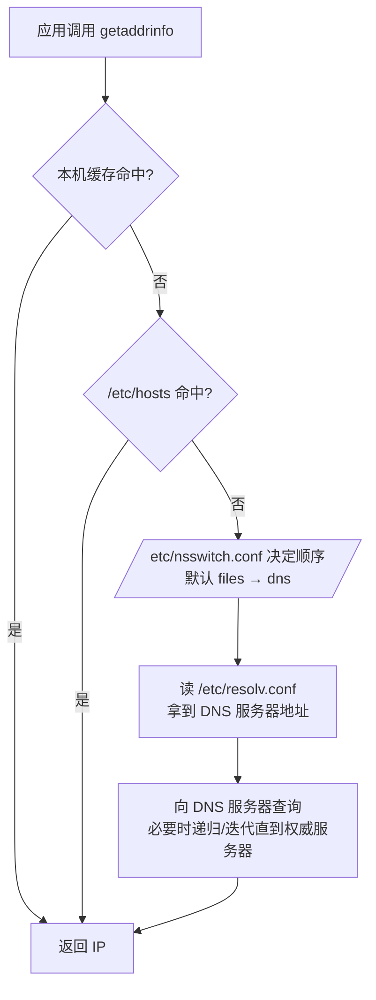

**一句话本质**：DNS 把「人类域名」翻成「网络 IP」，**查询按固定顺序逐级下探、缓存优先**；翻译完成后使命结束——之后包上写的都是 IP。

## 查询顺序（本机侧）

| 配置 | 作用 | 查看命令 |
|---|---|---|
| `/etc/hosts` | 手动指定 域名→IP，**优先级最高** | `cat /etc/hosts` |
| `/etc/nsswitch.conf` | 决定查询顺序（files 先还是 dns 先） | `grep ^hosts /etc/nsswitch.conf` |
| `/etc/resolv.conf` | 指定 DNS 服务器 | `cat /etc/resolv.conf` |

## 递归 vs 迭代（两个层级）

| 类型 | 谁对谁 | 特点 |
|---|---|---|
| **递归查询** | 你的机器 → 本地 DNS 服务器 | 你只问一次，剩下的它负责 |
| **迭代查询** | 本地 DNS → 根 → 顶级域(.com) → 权威服务器 | 本地 DNS 逐级问出答案，再回给你 |

## 常见坑

- `/etc/resolv.conf` 指向 `127.0.0.53`：这是 **systemd-resolved 的本地转发器（stub）**，不是异常；它再替你去上游递归
- 解析结果不一致：先查缓存与 hosts——hosts 优先级最高，改它会覆盖 DNS

## 排障命令

| 目的 | 命令 |
|---|---|
| 按系统真实顺序解析（最贴近应用行为） | `getent hosts <域名>` |
| 直接问 DNS 服务器（绕过 hosts/缓存） | `dig <域名>`、`nslookup <域名>` |
| 看 systemd-resolved 状态与上游 | `resolvectl status` |
| 跟踪解析过程 | `dig +trace <域名>` |

## 相关

- [网络分层与出网链路](/wiki/cloud-native/network-layer-stack)
- [DHCP 地址分配](/wiki/cloud-native/dhcp-address-assignment)
- [ARP 机制与广播风暴](/wiki/cloud-native/arp-mechanism)